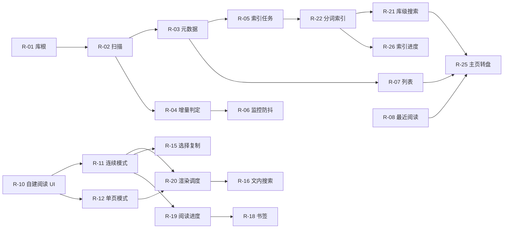

# 01 · 需求分析

> 依据 master_plan.md §5.1（第 349–364 行）：需求要分类、要识别依赖、要显式列出冲突与默认方案。
> 编号规则：`R-xx` 功能需求，`N-xx` 非功能要求，`F-xx` 首版范围判定。行号引用以本文件写作时实测为准。

## 1. 需求分类

### 1.1 核心功能（R）

| ID | 需求 | 来源 |
|---|---|---|
| R-01 | 添加 / 移除多个本地文献库根目录，可禁用而不删除 | master_plan §3.1 第 91、102 行 |
| R-02 | 递归扫描库根，只识别 PDF 文件 | §3.1 第 94–95 行 |
| R-03 | 提取并保存页数与元数据（标题/作者/主题/关键词/生产者/创建者/创建时间） | §3.1 第 97–98 行；04 §3 `documents` 第 44–71 行 |
| R-04 | 增量判定：新增 / 修改 / 删除 / 移动四类，用 (rel_path, size, mtime) 三元组而非全量哈希 | §3.1 第 99–101 行；02 §8 第 262 行 |
| R-05 | 新文件自动创建索引任务；失败重试上限 3 次后置 `failed` | §3.1 第 100 行；02 §6 第 200–204 行 |
| R-06 | 运行时文件监控 + 800ms 防抖聚合 | §3.1 第 99 行；02 §8 第 248 行 |
| R-07 | 文献列表：排序（name/recent/added/size）+ 按库根与索引状态筛选 + 分页 | §3.1 第 103 行；05 §2 `DocumentQuery` 第 94–101 行 |
| R-08 | 最近阅读记录与「继续阅读」入口 | §3.1 第 104 行；05 §3 第 181 行 `document_recent` |
| R-09 | 异常兜底：重名文件、路径变化、文件损坏、无访问权限 | §3.1 第 106 行；04 §4 第 154–156 行 |
| R-10 | 完全自定义阅读界面，不以 PDF.js Viewer UI 为基础 | §3.2 第 112–114、128 行；D02 |
| R-11 | 连续滚动阅读模式 | §3.2 第 144 行；`ReadMode = "continuous"` |
| R-12 | 单页翻页阅读模式，且与连续模式共享同一文档实例 | §3.2 第 145、155 行；02 §5 第 178 行 |
| R-13 | 页面缩放，缩放锚点保持阅读位置 | §3.2 第 146 行；05 §7 第 330 行 `setScale(s, anchor?)` |
| R-14 | 快速跳页 | §3.2 第 147 行 |
| R-15 | 文本选择与复制 | §3.2 第 148 行；05 §7 第 332 行 `getSelectionText()` |
| R-16 | 当前文档内搜索：结果计数、页码、上下文、上一个/下一个跳转、文本层高亮 | §3.2 第 149–150 行；§3.4 第 204–211 行 |
| R-17 | PDF 目录（Outline）导航；Outline 只读、不落库 | §3.2 第 151 行；03 M12 第 149 行；04 §3 第 117 行 |
| R-18 | 用户书签 CRUD + 跳转，与 PDF 内置 Outline 分开存储 | §3.6 第 268–274、287 行；04 §3 `bookmarks` 第 117–129 行 |
| R-19 | 阅读进度自动保存与恢复（页码 / 滚动比例 / 缩放 / 模式 / 更新时间） | §3.6 第 276–285 行；04 §3 `reading_progress` 第 132–140 行 |
| R-20 | 渲染调度：只渲染可视区与预取窗口、页面缓存、并发上限、取消过期任务、切换文档释放旧资源 | §3.2 第 157–168 行；02 §9 第 274 行 |
| R-21 | 全局库级搜索：返回文档 + 页码 + 上下文 + 命中区间，可按文档分页 | §3.4 第 213–219 行；05 §2 `GlobalSearchPageDto` 第 143–146 行 |
| R-22 | 中文全文索引：jieba 精确模式预分词写入 FTS5，查询侧使用同一切分 | §3.4 第 221–225 行；04 §7 第 184–185 行 |
| R-23 | 三套主题（light / dark / paper）；暖色不修改 PDF canvas 像素 | §3.5 第 249–262 行；D07 |
| R-24 | 设置持久化（键值 + JSON 字符串，未知键回退默认不抛错） | 04 §3 `app_settings` 第 143 行；04 §4 第 162 行 |
| R-25 | 主页空间转盘：书脊沿圆周排布，可见弧渲染并交互，隐藏弧零 DOM | 13 §2 第 20–50 行 |

### 1.2 辅助功能（R）

| ID | 需求 | 来源 |
|---|---|---|
| R-26 | 索引进度可见：队列 / 运行 / 已索引 / 待索引 / 失败 / 无文本 / 当前页 | 05 §2 `IndexStatusDto` 第 116–122 行；05 §4 第 217 行 |
| R-27 | 索引暂停 / 恢复 | 05 §3 第 187 行 `index_pause` |
| R-28 | 索引全量重建（清空 FTS 与 page_text 后重新入队） | 05 §3 第 188 行；04 §6 第 180 行 |
| R-29 | 一致性自检报告：FTS 行数 / 孤儿页 / 状态错标文档（只报告不自动修） | 05 §3 第 199 行；04 §6 第 179 行 |
| R-30 | 快捷键：缩放、跳页、搜索、返回 | §3.3 第 184 行；13 §3 第 76–81 行 |
| R-31 | 面板编排：可展开文献列表、悬浮搜索面板、按需侧栏 | §3.3 第 176–184 行 |
| R-32 | 运行环境自述：版本、数据目录、db 路径、FTS 能力 | 05 §3 第 173 行 `app_info` |
| R-33 | 打开时间戳与「最近打开」排序依据 | 05 §3 第 182 行 `document_touch_opened` |

### 1.3 非功能要求（N）

| ID | 要求 | 可测目标值见 | 来源 |
|---|---|---|---|
| N-01 | 首屏可读时间 | §5 | §4.1 第 300 行 |
| N-02 | 连续滚动流畅度（帧率与长任务） | §5 | §4.1 第 302 行 |
| N-03 | 搜索响应 P95 | §5 | §4.1 第 303 行 |
| N-04 | 索引吞吐与前台让位 | §5 | §4.1 第 299、306–310 行 |
| N-05 | 内存峰值与资源释放 | §5 | §4.1 第 304–305 行 |
| N-06 | 冷启动时间 | §5 | §4.1 第 306 行 |
| N-07 | 数据库体积 | §5 | 04 §8 第 190–198 行 |
| N-08 | 稳定性：损坏 / 无文本 / 扫描版 / 超大 / 外部修改 / 索引期删除 / DB 异常 / 意外退出 | §5 N-08 行 | §4.2 第 314–325 行 |
| N-09 | 可维护性：无循环依赖、无巨型组件、前端不依赖表结构、关键服务有接口、重要功能有测试 | 03 §4 与 05 §9 | §4.3 第 331–341 行 |
| N-10 | 错误可观测：统一 `ApiError`，静默吞错即缺陷，日志滚动保存 7 天 | 02 §10 第 281–285 行 | §4.2 第 322 行 |

### 1.4 首版范围判定（F）

| ID | 判定 | 覆盖需求 | 理由 |
|---|---|---|---|
| F-01 | 首版必须 | R-01 R-02 R-03 R-04 R-09 | 库管理是检索与阅读的唯一入口，缺一条则整库不可用 |
| F-02 | 首版必须 | R-05 R-06 | 无自动入队则库级检索永远为空；无监控则外部改动即失效 |
| F-03 | 首版必须 | R-07 R-08 | 列表与最近阅读是 homepage 与 library 视图的数据基础（13 §4 第 107 行） |
| F-04 | 首版必须 | R-10 R-11 R-12 R-13 R-14 R-15 R-20 | 阅读器主体；R-20 不达标则大文件不可读 |
| F-05 | 首版必须 | R-16 R-17 | 文内搜索与目录是阅读闭环的一部分，不是增强项 |
| F-06 | 首版必须 | R-18 R-19 | 进度不保存等于每次重读；契约里 `reading_progress` 是表而非选项 |
| F-07 | 首版必须 | R-21 R-22 | 产品的核心差异点，P1 痛点（00 §3）全靠这两条 |
| F-08 | 首版必须 | R-23 R-24 | 护眼是硬需求；设置表是主题与索引开关的落点 |
| F-09 | 首版必须 | R-25 | 用户亲自设计的入口，`home` 是主路由（13 §6 第 124 行） |
| F-10 | 首版必须 | R-26 R-27 | 索引是长时间任务，无进度即不可预期的等待 |
| F-11 | 首版必须 | R-28 R-29 R-32 R-33 | 均在 05 §3 的 28 个 Command 内，属契约已定义项，不做即契约缺口 |
| F-12 | 首版必须 | R-30 R-31 | 快捷键与面板编排是 §3.3 的交互骨架；具体取值仍待用户拍板 |
| F-13 | 暂缓 | 书脊封面取色（读 PDF 首页取色） | 13 §7 第 135 条明确「首版建议不做」；需 M05 额外能力 |
| F-14 | 暂缓 | `page_text.raw_text` 压缩列 | 04 §8 第 198 行标注为「迁移 002，非首版」 |
| F-15 | 未来扩展 | 页面像素级暖色处理（纸面本身变暖） | D07 第 297 行；master_plan §3.5 第 264 行「允许未来扩展」 |
| F-16 | 未来扩展（已排除） | OCR | D11 第 301 行；master_plan §4.2 第 327 行。只有重开架构设计才考虑 |

## 2. 需求依赖图

**两条独立的长链 + 一个汇聚点。**

1. 后端检索链：R-01 → R-02 → R-03 → R-05 → R-22 → R-21。任一环缺失，库级检索就没有数据源；这条链的最后一环（R-22）依赖 `page_text`/`page_fts` 双表与 jieba 分词器，是全项目最慢的一条（04 §7）。
2. 前端阅读链：R-10 → R-11/R-12 → R-20 → R-16。它只需要 M02 契约，**不需要任何 Rust 业务模块**（03 §3 第 205 行），因此可以与检索链并行推进。
3. 汇聚点：R-25 主页转盘同时消费「最近阅读」（R-08）、「列表」（R-07）与「检索结果」（R-21），所以它是最后接线、且必须能先对 mock 数据源开发的那一个（03 §3 第 205 行）。
4. 所有 R 都隐含依赖 05 §3 的 28 个 Command 与 05 §4 的 5 个事件——这是**契约依赖**，不是可选项；契约本身的实现顺序见 10-development-roadmap.md。

## 3. 需求冲突与默认方案

每条格式固定：冲突 → 默认方案 → 影响 → 需要用户拍板的点。「无需拍板」也是结论，写出来。

### C-01 中文分词召回 vs 查询速度
- **冲突**：jieba 预分词能召回「中文分词」这类词，但查询串必须切分并构造 MATCH；04 §7 第 185 行要求查询侧与写入侧「同一分词器与同一词典配置」，否则召回静默变差。库变大后单次查询成本随 token 数与页数上升。
- **默认方案**：写入侧只存 jieba 精确模式切分的空格连接串（04 §7 第 184 行）；查询侧复用同一分词器单例（03 M09 第 118 行）；短语模式 = 相邻 token 序列，宽松模式 = AND；不引入 trigram（D05 第 295 行，trigram 对 <3 字符中文查询受限）。超时策略是降 `hitsPerDocument`（默认 3、上限 5，05 §2 第 130 行），**不缩召回**。
- **影响**：召回质量绑定 jieba 词典版本；词典或分词逻辑一变，必须重建索引（等价于 `text_state` 全部回 `pending`）。V-04 未关闭前，「分词对称」不得写成已确认事实。
- **待拍板**：无需拍板（技术取舍）。但「输入短语时默认短语模式还是宽松模式」属交互取向 —— `SearchMode` 两个值已冻结（05 §2 第 124 行），默认值待用户确认。

### C-02 库级检索 vs 阅读流畅（CPU 竞争）
- **冲突**：文本提取是 CPU + IO 密集，检索走 SQLite 读连接，页面渲染占主线程与 GPU。三者抢同一台机器。
- **默认方案（契约已定，非本文件自创）**：后台提取走独立 `spawn_blocking` 池，信号量上限 **2**；每批 8 页后 `yield` 并检查取消；用户当前打开的文档 `priority=0`，后台 `priority=10`；让位机制是「批间检查」而非线程抢占（02 §9 第 272–277 行）。
- **影响**：索引吞吐上限约等于 2 个 worker 的和；阅读期间索引变慢是**设计内行为**，不算缺陷（01 §5 N-04 已按此定目标）。
- **待拍板**：阅读时是否默认暂停索引（`index_pause`，05 §3 第 187 行）。默认方案是不暂停、只让位；若要绝对流畅需加「进入阅读器自动暂停」，这属行为取向，需用户决定。

### C-03 暖色护眼 vs 图表/扫描件颜色保真
- **冲突**：用户要求暖色纸张作为主护眼模式（master_plan §3.5 第 253 行），但明确警告不要用 CSS filter 反转整个 canvas，否则破坏图片与图表颜色（第 262 行）。
- **默认方案**：只改**外围背景**，叠加可选的**低透明度暖色光罩**，不修改 PDF canvas 像素（D07 第 297 行）。令牌集合由 M13 定义并冻结变量名（03 M13 第 158、163 行）。
- **影响**：纸面本身不变暖；用户若坚持「纸面也变暖」，需要像素级处理，已列 F-15（未来扩展）。
- **待拍板**：光罩透明度、是否默认开启、暗色下暖色如何降级 —— 全部是视觉数值，进「【待你确认】」。

### C-04 扫描版 PDF vs 全文检索
- **冲突**：无文本层 PDF 可以打开阅读，但索引不出文本；若不显式处理，用户看到的是「索引永远在跑」或「一直失败」。
- **默认方案**：不实现 OCR（D11）；提取不到文本 → `text_state=no_text` + `E_PDF_NO_TEXT`，**不重试**（02 §6 第 192 行）；加密 → `E_PDF_ENCRYPTED`，任务 `failed` 但应用不崩溃（03 M09 第 124 行）。`no_text` 与 `failed` 都是终态，只有 mtime 变化或手动重建才重试（04 §4 第 156 行）。
- **影响**：扫描件永久不进库级检索，这是**已知限制**，必须写进发布文档（03 M15 第 178 行）。
- **待拍板**：`no_text` 在书脊与列表上的标记表现（13 §4 第 97 行留了 `textState` 字段，表现标注【待确认表现】）。

### C-05 单页 / 连续共享文档实例（master_plan §3.2 第 155 行）
- **冲突**：最省事的实现是两种模式各建一条渲染路径、各自 `getDocument`；但契约禁止：切换模式绝不重新 `getDocument`（02 §5 第 178 行）。
- **默认方案**：一个 `PDFDocumentProxy` 由 M05 持有（`DocumentHandle`，05 §7 第 257–264 行）；切换模式只改 `RenderScheduler` 的视口模型（`ViewportState.mode`，05 §7 第 306 行）。验收方式是可断言的：模式切换前后 `getDocument` 调用次数不变（03 M07 第 104 行）。
- **影响**：模式切换必须自己维持 `currentPage` 与页内相对位置 `scroll_ratio`；缩放必须显式传锚点（`setScale(s, anchor?)`，05 §7 第 330 行），否则会跳到页首。
- **待拍板**：切换瞬间是否需要过渡动画（视觉取向）。

### C-06 用户书签 vs PDF Outline（master_plan §3.6 第 287 行）
- **冲突**：两者都表现为「点一下跳到某页」，容易被实现成一棵混合树，导致用户书签被 PDF 内嵌数据覆盖或反过来污染 Outline。
- **默认方案**：`bookmarks` 表只存用户书签（04 §3 第 117–129 行，表注释明确「与 PDF 内置 Outline 完全无关」）；Outline 由 `DocumentHandle.getOutline()` 只读提供（05 §7 第 261 行），**不落库**（03 M12 第 149 行）。Outline 取失败返回 `[]`，不抛错（05 §7 第 261 行）。
- **影响**：Outline 不能加备注/颜色；删除文档记录时书签随级联消失（04 §6 第 176 行）；Outline 每次打开都要重新解析（不缓存到库）。
- **待拍板**：导航面板中书签与目录是并列两个列表、还是合并一棵树 —— 交互取向，需用户决定。

### C-07 超大 PDF 内存 vs 预取范围
- **冲突**：预取越多滚动越顺，但 ≥300MB 文档可能直接打爆内存。三个旋钮互相拉扯：`RenderBudget { maxConcurrent, cacheBytes, prefetchPages }`（05 §7 第 312 行）。
- **默认方案**：字节流走 `pdf://` + Range 分段（D01），PDF.js 自行分段加载；只渲染可视区 + 预取窗口，并发默认 **2**（02 §9 第 274 行）；Canvas LRU 按字节预算逐出（03 M06 第 86 行）。调参顺序固定：先降 `prefetchPages`，再降 `cacheBytes`，最后才降 `maxConcurrent`。
- **影响**：三个默认数值目前**没有实测依据**，必须先关闭 V-07 才能定版；未验证前按保守值起步，并把校准过程与结果落在 08-rendering-and-performance.md。
- **待拍板**：无需拍板（由实测定）。但「大文件下是否允许降级渲染质量换取流畅」属产品取向，需确认。

### C-08 主页转盘「只渲染可见」vs 数据可得性
- **冲突**：13 §2 第 48 行要求隐藏弧**不生成任何 DOM 节点**（不是 display:none / visibility:hidden / opacity:0）；但焦点书识别、键盘遍历、以及「转一圈回到同一角度」需要全量 N 的角度与元数据。只加载可见项就无法预知下一个是谁。
- **默认方案**：`HomeDataSource.load()` 一次返回全量 `HomeBook[]`（13 §4 第 100–103 行）；DOM 只为可见弧内条目创建，上限 = `ceil(visibleArc/360 × N) + 2`（13 §5 第 116 行，用 `[data-home-spine]` 计数验证）；旋转用 `transform`/`opacity` 直接改 DOM，拖拽期间 React 重渲染次数必须为 0（第 119 行）。
- **影响**：数据层内存与首屏计算随 N 线性增长，因此默认数据源是「最近阅读 + `document_list` 补齐」（13 §4 第 107 行），把 N 控制在阅读习惯范围内；N=0/1/2 走特例布局，不进环模型（13 §4 第 109 行）。
- **待拍板**：首版取多少本进环（`document_recent` 的 limit）、`visibleArc` 角度、`R`/`spineH`/`spineW` 全部数值 —— 见 13 §7 第 133 条，均不得由 Agent 赋值。

## 4. 用户故事

**US-01 加库**：作为使用者，我要把一个文件夹加进文献库，以便下次不必用文件管理器找论文。验收要点：`library_root_add` 返回 `LibraryRootDto`；同一路径重复添加不得产生第二行（`path` UNIQUE，04 §3 第 36 行）；列表立即出现该根。

**US-02 扫库**：作为使用者，我要一次扫描就看到目录里所有 PDF，以便判断库是否建对。验收要点：`library://scan-progress` 依次出现 `walking → finalizing → done`（05 §4 第 215 行）；`scanned` 等于目录内 PDF 实际数量；扫描期间 UI 不冻结。

**US-03 列表浏览**：作为使用者，我要按名称/最近/添加时间/大小排序并筛出未索引的文献，以便知道哪些还没进检索。验收要点：`document_list` 分页默认 50、上限 200（05 §2 第 100 行）；`textStates` 过滤生效。

**US-04 主页转盘选书**：作为使用者，我要在主页转一圈书脊就进到想读的那本，以便不以「文件列表」的方式选书。验收要点：只有可见弧内的书脊有 DOM（`[data-home-spine]` 计数）；点击书脊 → 旋转到中央并聚焦 → Enter 进入 reader（13 §3 第 61–70 行）。

**US-05 连续阅读**：作为使用者，我要一直往下滚不用点下一页，以便读长文。验收要点：任意时刻只有可视区与预取窗口的页有 canvas；离开视口的页被 LRU 回收。

**US-06 单页阅读**：作为使用者，我要一页一页看图表，以便快速对照。验收要点：模式切换后 `currentPage` 不变、`getDocument` 调用次数不变（02 §5 第 178 行）。

**US-07 缩放**：作为使用者，我要放大看公式，以便看清上下标。验收要点：`setScale(s, anchor)` 之后锚点所在页仍在视口内（05 §7 第 330 行）；缩放过程取消窗口外的过期 `renderTask`（02 §5 第 169 行）。

**US-08 跳页**：作为使用者，我要输入页码直接到第 200 页，以便按引用位置读书。验收要点：`goToPage(200)` 之后不出现「先渲染第 1 页再跳」的闪烁（02 §5 第 179 行）。

**US-09 复制**：作为使用者，我要选中一段文字复制到笔记里，以便引用。验收要点：`getSelectionText()` 返回选中文本（05 §7 第 332 行）；跨行选择不丢字。

**US-10 文内搜索**：作为使用者，我要在这篇里找关键词，以便定位到自己记得的段落。验收要点：结果总数正确、可按上一个/下一个跳转、命中在文本层高亮（03 M08 第 108–111 行）；中文子串匹配不依赖分词。

**US-11 库级搜索**：作为使用者，我要在整个库里搜一句话，以便找到不记得文件名的那篇。验收要点：`search_global` 返回 `GlobalSearchPageDto`，含每文档 `hitCount`、`snippet` 与 `ranges`；点击结果打开文献并跳到 `pageNo` 且高亮（02 §7 第 228–230 行）。

**US-12 书签**：作为使用者，我要给某页打书签并写一句备注，以便下次直接回去。验收要点：`bookmark_create/update/delete` 生效、重启后仍在（04 §3 第 118–129 行）；与 Outline 互不影响（§3 C-06）。

**US-13 进度恢复**：作为使用者，我要重开文献时回到上次位置，以便接着读。验收要点：`progress_save` 节流 1s 且不丢最后一次（03 M12 第 154 行）；恢复时 `page_no` 按新 `page_count` 夹取（04 §4 第 161 行）。

**US-14 主题切换**：作为使用者，我要在浅色/深色/暖色之间切，以便夜里读着不刺眼。验收要点：`settings_set` 持久化、重启保持；切主题不改变 PDF 页面像素（D07）；三套主题令牌名集合相等（03 M13 第 164 行）。

**US-15 索引进度可见**：作为使用者，我要看到还剩多少篇在索引，以便决定现在读还是等一会。验收要点：`index_status` 与 `index://progress`（≤4 次/秒，05 §4 第 217 行）一致；暂停后 `paused=true` 且队列不再消耗。

## 5. 非功能指标表

目标值为**可验收的默认提案**；不达标时按 C-07 的固定顺序调参（先预取、再缓存、最后并发），不擅自改协议或契约。

| ID | 指标 | 目标值 | 测量方法（可执行） |
|---|---|---|---|
| N-01 | 首屏可读时间 | 普通文档（≤10MB、≤50 页）P95 ≤ 800ms；≥300MB 文档 ≤ 2.5s（**受 V-07 约束，未验证前是假设值**） | 在 `document_url`（05 §3 第 180 行；02 §5 的图示笔误已由 R6 修订） 返回 → 首页 canvas ready 之间打 `performance.mark`，重复 5 次取 P95 |
| N-02 | 连续滚动帧率 | 100 页文档 @1920×1080、连续滚动 3s：P95 帧间隔 ≤ 18ms（≈55fps），>50ms 长任务 0 次 | `PerformanceObserver` 采 longtask + rAF 采样脚本，各 3 轮 |
| N-03 | 搜索响应 | 100k 页合成库（4000 文档 × 25 页）：`search_global` P95 ≤ 300ms，`search_global_count` ≤ 150ms | 造数脚本灌库，同一查询串调用 50 次取 P95 |
| N-04 | 索引吞吐 | ≥ 8 页/秒（信号量 2，中文论文 15 页/篇 ⇒ ≤ 2s/篇） | 20 篇样本，计时 `text_state` 从 `pending` 到 `indexed` |
| N-05 | 内存峰值 | 常规阅读 RSS ≤ 900MB；300MB 文档 ≤ 1.5GB；关闭文献后 60s 内回落 ≥ 70% | 进程内存采样（任务管理器/Process Explorer），关闭前后各一次 |
| N-06 | 冷启动 | 空库 ≤ 1.5s；4000 文档库 ≤ 2.5s（不含索引）到主页可交互 | 打点：进程启动 → `HomeSpace` 首次可交互 |
| N-07 | 数据库体积 | `page_text` + `page_fts` ≤ 1.6 × 原文 UTF-8 字节数；1000 篇 ≤ 400MB | 库文件字节数 ÷ `SELECT SUM(char_count*3) FROM page_text`（按 CJK 每字 3 字节取保守下界）；估算口径见 04 §8 第 192–196 行 |
| N-08 | 索引失败处置 | 损坏/加密/扫描样本跑批：崩溃 0 次，失败项 100% 带 `index_error_code` | 样本集批量入队，断言进程存活且每条失败都有错误码 |

补充约定：N-01 与 N-05 的数值在 V-07 关闭后必须重新校准一次，校准结果写入 08-rendering-and-performance.md，并回填本表。

## 6. 明确不做清单（与 00 §6 一致，此处给出需求侧判定）

1. OCR、扫描件文字识别（D11；F-16 已排除）。
2. 注释、批注、签名、表单填写（master_plan §3.2 第 125–126 行）。
3. 云同步、账号、多设备（D12）。
4. 多人协作、共享文献库（单人产品）。
5. 插件系统、脚本扩展（无接口稳定性承诺）。
6. PDF 编辑、格式转换、导出（不在 §3 任何小节）。
7. 移动端 / Web 端（本项目是 Windows 桌面 Tauri 应用，打包见 03 M15 第 178 行）。
8. 检索的同义词扩展、拼写纠错、语义检索 —— 契约只定义了 `phrase` 与 `terms` 两种模式（05 §2 第 124 行）。
