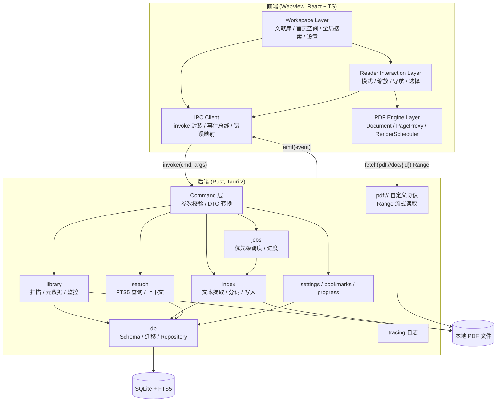
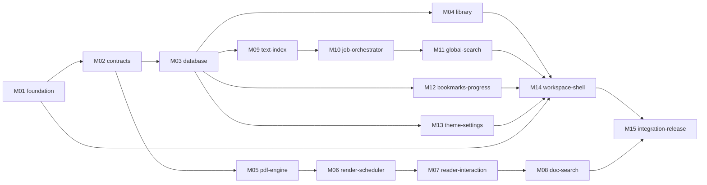
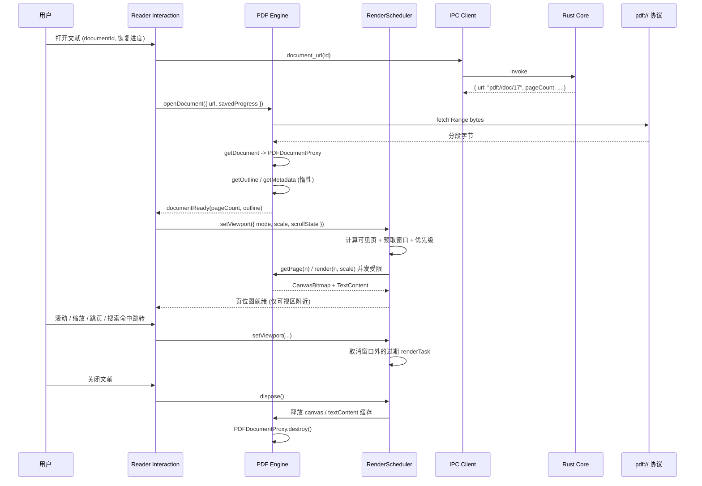
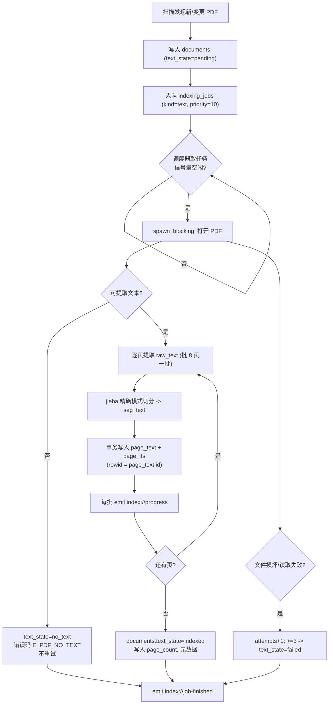
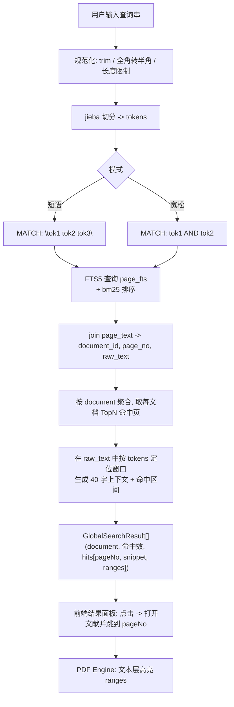
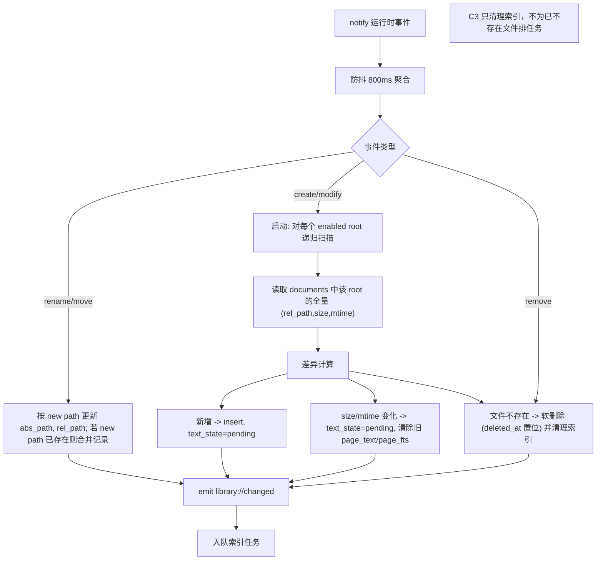

# 02 · 系统总体架构

> 本文档是**冻结契约**（Frozen Contract）。所有模块 Prompt 必须与之保持一致；任何模块若需要修改本文档定义的边界、数据流或依赖方向，必须在交付报告中标记为「架构变更」并等待 Lead 批准。
> 依据：master_plan.md §5.2、§5.5、§十。

## 1. 技术栈与版本策略

| 层 | 技术 | 版本策略 |
|---|---|---|
| 桌面框架 | Tauri 2 | `tauri = "2"`，锁 `Cargo.lock` |
| 后端 | Rust (stable, edition 2021) | `rust-toolchain.toml` 固定 |
| 前端 | React + TypeScript + Vite | `react ^19`、`vite ^6`（生态兼容时可升 ^7），`package.json` 精确锁 |
| PDF 引擎 | pdfjs-dist（**仅 Display API**） | **固定次版本**，见 V-01 |
| 数据库 | SQLite via `rusqlite` `0.43.x`，feature `bundled` | 内含 SQLite 3.54.1 |
| 全文检索 | SQLite FTS5 | 见 V-03 |
| 中文分词 | `jieba-rs` `0.7.x` | 见 V-04 |
| 异步 | `tokio 1.x`（multi-thread） | — |
| 文件监控 | `notify 8.x` | 见 V-05 |
| 前端状态 | `zustand ^5` | — |
| 样式 | Tailwind CSS `^4`（CSS-first 配置） | 若选 3.x 需另配 config |
| 序列化 | `serde` / `serde_json` | — |
| 日志 | `tracing` + `tracing-subscriber` | 滚动文件日志 |

### 待验证项（V 清单）

未经验证的事实**不得**在代码或文档中当作已确认结论使用。每项都必须由一个可执行的探针关闭，并在交付报告中记录结论。

> **V-06 结论（2026-11-18 关闭）**
>
> 实测日志（`LEGERE_LOG=info`，真实 WebView2 请求）：
>
> ```text
> pdf:// 请求进入 uri=pdf://localhost/doc/1 range=None method=GET
> pdf:// 响应     status=200 content_range=None body_len=599
> pdf:// 请求进入 uri=pdf://localhost/doc/1 range=Some("bytes=0-9") method=GET
> pdf:// 响应     status=206 content_range=Some("bytes 0-9/599") body_len=10
> ```
>
> 结论：
> 1. **Windows 上的真实 URL 形态是 `pdf://localhost/doc/{id}`** —— scheme 之后的主机名固定为 `localhost`，不是原先假设的 `http://pdf.localhost/`。`parse_document_id` 已同时支持该形态与 `pdf://doc/{id}`，并有回归断言锁死（`protocol::tests`）。
> 2. **Range 端到端可用**：带 `Range: bytes=0-9` → `206` + `Content-Range: bytes 0-9/599` + 10 字节；不带 Range → `200` + 完整 599 字节。浏览器接受 206，说明自定义协议的 Range 语义按契约 R15 生效。
> 3. **后续实测修正（同日，release + 生产目录 + 真实页面）**：前端若直接用 pdf://doc/1 fetch 会得到
>    TypeError: Failed to fetch；改用 http://pdf.localhost/doc/1 则 200 / 带 Range 得 206 + bytes 0-9/599。
>    跨源响应还必须带 CORS 头并应答 OPTIONS 预检，否则 JS 读不到响应。契约已按此修订为 **R21**（docs/05 §6）。
>    结论：**后端 Range 语义正确；前端必须使用平台映射形态 URL**（Windows = http://pdf.localhost/...）。

| ID | 待验证内容 | 探针（可执行、可判定） | 责任模块 |
|---|---|---|---|
| V-01 | pdfjs-dist 目标版本的 TextLayer API 形态（`renderTextLayer` 是否已移除、`TextLayer` 类的构造签名、`canvasContext` 参数） | `npm view pdfjs-dist version` + 读该版本 `types/src/display/api.d.ts` 与 `text_layer.d.ts`，抄录签名 | M05 |
| V-02 | 各 crate 实际可用版本号 | `cargo add --dry-run` 或 `cargo tree` 输出 | M01 |
| V-03 | 本次捆绑的 SQLite 是否启用 FTS5，以及是否支持 `contentless_delete` | 启动时执行探针 SQL：`CREATE VIRTUAL TABLE t USING fts5(a, content='', contentless_delete=1)`，捕获结果并写日志 | M03 |
| V-04 | jieba-rs 精确模式在「中英混排 + 标点」上的切分结果是否符合索引/查询对称要求 | 单元测试：同一文本切分两次结果一致；查询串切分与文档串切分使用同一词典配置 | M09 |
| V-05 | notify 在 Windows 上的重命名/移动事件语义（是否成对给出 Remove+Create） | 手工探针程序记录事件序列 | M04 |
| V-06 | Tauri 2 自定义协议在 Windows 上的实际 URL 形态与 Range 请求可支持性 | 最小壳工程：注册 `pdf` scheme，用 `fetch` 发 `Range: bytes=0-` 并打印状态码 | M01 · **已关闭（2026-11-18，见下注）** |
| V-07 | 大 PDF（>300MB）经自定义协议 + Range 时 PDF.js 的分段加载行为 | 用真实样本测量首屏时间与内存 | M05/M06 |
| V-08 | `page.cleanup()` 之后重新 render 的重解析耗时与内存回落 | 单测 render→cleanup→render + 打点；判据 重解析 ≤ 80ms、堆回落 ≥ 单页位图量 | M05 |
| V-09 | pdfjs worker 是否随打开次数增长（共享 vs 一文档一个） | 打开/关闭循环 20 次，观察线程数与堆；判据 线程数恒定、堆增长 < 20MB | M05 |

## 2. 分层与依赖方向（硬约束）

```text
┌──────────────────────────────────────────────────────────────┐
│ L4  Workspace Layer (React)   文献库 / 首页空间 / 全局搜索 / 设置 │
├──────────────────────────────────────────────────────────────┤
│ L3  Reader Interaction Layer  阅读模式 / 缩放 / 导航 / 选择 / 进度 │
├──────────────────────────────────────────────────────────────┤
│ L2  PDF Engine Layer (TS)     Document / PageProxy / 渲染调度      │
├──────────────────────────────────────────────────────────────┤
│ L1  IPC Client (TS)           invoke 封装 / 事件订阅 / 错误映射     │
╞══════════════════════════════════════════════════════════════╡
│ L0  Rust Core (Tauri)         db / library / index / search / fs   │
└──────────────────────────────────────────────────────────────┘
```

依赖方向规则（违反即缺陷）：

1. L2 只能被 L3/L4 使用，**L2 不得 import 任何 L3/L4 模块**。
2. L3/L4 **禁止**直接 `import "pdfjs-dist"`；只能经由 `src/pdf-engine/` 的公开接口。
3. L3/L4 **禁止**直接使用 SQLite/Repository/FTS 概念；只能经由 L1 的 DTO。
4. L0 不依赖前端任何类型定义；前端类型由 M02 契约层按 L0 DTO 手写镜像并在 CI 中做「字段名一致性检查」。
5. 任何层不得跨层调用（如 L4 直接调 L2 内部渲染实现，跳过 L3）。

## 3. 系统总体架构图



**文字说明**

- 前端与后端之间只有两条通道：`invoke`（请求-响应，Tauri Commands）与 `emit/listen`（单向事件）。
- PDF 字节流**不经过 invoke**：WebView 用 `fetch` 请求 `pdf://` 自定义协议，Rust 端按 HTTP Range 读文件，PDF.js 自行分段解析。避免了「一次性把整个 PDF 序列化进 IPC」的致命内存问题。
- 数据库只被 Repository 访问；Command 层只做参数校验与 DTO 转换，不写 SQL。
- 后台索引与前台阅读共享同一 Runtime，但占用独立的 `spawn_blocking` 线程池并以信号量限流（见 §7）。

## 4. 核心模块依赖图



依赖图的读法：箭头 A → B 表示「B 需要 A 已完成的接口」。M14 在 M04/M11/M12/M13 之前就可开工，但只能基于 **mock 数据源**；真实接线在其依赖就绪后由同一模块补齐。

## 5. PDF 阅读流程图



**文字说明**

1. 文档只加载一次；连续滚动与单页翻页**共享同一个 `PDFDocumentProxy`**，切换模式只改变 `RenderScheduler` 的视口计算与布局，绝不重新 `getDocument`。
2. 打开顺序固定为：URL → 文档就绪 → 视口 → 首屏渲染；进度恢复发生在视口建立之前，因此不会出现「先渲染第 1 页再跳到第 200 页」的闪烁。
3. 所有渲染任务由 Scheduler 持有，React 组件只订阅「页位图就绪」事件，不自己发起 `page.render()`。

## 6. 全文索引流程图



**文字说明**

- 索引是**页面级**的：`page_text` 一行一页，`page_fts` 一行一页，两条记录通过 `rowid` 绑定，使搜索结果天然能定位到页码。
- 事务以「批」为单位（默认 8 页）：崩溃时最多丢失一批，重启后 `text_state=indexing` 的记录被重置为 `pending` 重新入队。
- 不可提取文本的 PDF（扫描件）**不进入 OCR**，直接标记 `no_text` 并停止重试。
- 索引写库与阅读完全不共享锁：WAL 模式下读写并发，写事务短（批提交）。

## 7. 全局搜索流程图



**文字说明**

- 上下文与高亮区间**由 Rust 在原始文本上计算**，不使用 FTS5 `snippet()`——因为 `snippet()` 作用在分词后的 `seg_text` 上会插入空格，破坏原始排版。
- 命中区间以「页内字符索引区间」形式返回，前端用于文本层坐标映射（见 06/07）。
- 分页：先按文档聚合再取文档页，避免单文档几百命中占满首屏。

## 8. 文件变更与增量索引流程图



**文字说明**

- 扫描以 `(rel_path, size, mtime)` 三元组做增量判定，不计算全量哈希（大库成本过高）；下载中的文件用「mtime 距今 < 2s 则跳过本轮」规避半写状态。
- rename 优先按 `notify` 的成对事件处理；若成对事件缺失（V-05），退化为「先删除后新增」，用户可见后果仅是该文档重新索引一次。
- 任何扫描/监控结果最终都只是「更新 documents 状态 + 入队任务」，索引流程保持单一入口。
- **只有文件中确实存在**的记录才会被排入 `meta`/`text` 任务；`C3`（文件已消失/软删除）只清理索引与状态，**不排任何任务**（否则索引队列会被幽灵文档占满）。

## 9. 运行时与调度模型

| 资源 | 归属 | 约束 |
|---|---|---|
| Tauri 主线程 | 命令派发、事件发送 | 不做重 IO、不做 PDF 解析 |
| tokio worker | 异步命令（db 查询、事件） | 单次查询 < 50ms 为设计目标 |
| `spawn_blocking` 池（提取） | PDF 文本提取、哈希 | 信号量上限 **2**；每批 8 页后 `yield` 并检查取消 |
| 提取顺序 | 优先级队列 | 用户当前打开的文档 `priority=0`，后台 `priority=10` 先到先服务 |
| 前端渲染并发 | RenderScheduler | 默认 **2** 个并行 canvas 渲染；缩放变更时取消窗口外任务 |
| DB 连接 | `r2d2` 风格连接池或单写多读 | 写走单连接串行队列，读走只读连接；WAL |

「前台优先」的实现方式不是抢占，而是：**后台任务在每批之间检查 `index_pause` 标志与队列中是否出现 `priority < 当前` 的任务**，出现即主动让位。这样无需线程中断，无锁竞争。

## 10. 错误处理与日志

- 全局唯一错误类型 `ApiError { code, message, detail, retriable }`（定义见 05-api-contracts）。
- Rust 内部使用 `thiserror` 定义领域错误，在 Command 层统一 `impl From<DomainError> for ApiError`，**禁止把 `anyhow` 的字符串直接抛给前端**。
- 前端：`invoke` 封装统一 `throw ApiError`；UI 层按 `code` 决定提示文案，不解析 message。
- 日志：`tracing` 结构化日志，字段 `module`、`document_id`、`job_id`、`elapsed_ms`；默认 INFO，`LEGERE_LOG` 环境变量可调；日志文件滚动保存 7 天。
- 任何「静默吞掉错误」都视为缺陷；至少 `warn!` 一条并携带上下文。

## 11. 关键决策记录（Decision Log）

| ID | 决策 | 理由 | 代价/风险 |
|---|---|---|---|
| D01 | PDF 字节不经 IPC，用 `pdf://` 自定义协议 + Range 流式读取 | 避免大文件序列化与内存峰值；PDF.js 可惰性加载 | 需要自实现协议 handler 与 Range 语义（V-06） |
| D02 | 只用 pdfjs-dist 的 **Display API**，不复制 Viewer UI | master_plan §3.2 硬要求；Viewer 内部组件无稳定性承诺 | 分页布局、查找、文本层都要自己实现 |
| D03 | 文本提取在 **Rust 侧**通过 `TextExtractor` trait 完成，而非让 WebView 逐页提取 | 后台索引不应占用/污染阅读 WebView；关闭文献时仍需索引 | 引入第二套文本提取实现，需与 PDF.js 结果对齐（记录差异即可，不追求逐字一致） |
| D04 | 索引单位 = PDF 页面；`page_text`(原始) + `page_fts`(分词, contentless) 双表以 rowid 绑定 | 原始文本用于上下文/高亮与重建；分词表只承担匹配 | 存储翻倍（按 4k 文档估算 < 3GB，可接受） |
| D05 | FTS5 使用 `unicode61` + jieba 预分词，**不用** trigram | trigram 无法处理 <3 字符中文查询，且体积膨胀 | 查询侧必须做同一切分，否则召回不一致 |
| D06 | 上下文/高亮不用 `snippet()`，改由 Rust 在 raw_text 上计算 | `snippet()` 输出的是分词文本，空格破坏排版 | 需要自己实现窗口选取与区间映射 |
| D07 | 暖色纸张模式**不改 PDF canvas 像素**，只改外围背景，叠加可选低透明度暖色光罩 | 防止 CSS filter 破坏图表/扫描件颜色（master_plan §3.5） | 「纸面本身也变暖」需后续可选实现（需像素级处理） |
| D08 | 前端渲染调度独立于 React 组件，Scheduler 持有 canvas 与 LRU | 组件卸载/重挂不得丢帧或泄漏导出任务 | 需要自建所有权模型与显式 dispose 约定 |
| D09 | DTO 与数据库 Schema 严格分离；前端类型由契约层手写镜像 | master_plan §5.4 末段硬要求 | 字段改名需要三处同步（有 CI 检查） |
| D10 | `contentless_delete` 优先；探针失败则降级为普通 FTS5 表 | 减少索引膨胀，同时保留确定性降级路径 | 两条路径都要测（V-03） |
| D11 | 不实现 OCR；无文本 PDF 标 `no_text` 并停止重试 | master_plan §4.2 | 扫描件不可全文检索（已知限制） |
| D12 | 单实例单用户，无账号/无网络同步 | Local-first | 无多设备同步 |

## 12. 本模块对外的稳定性承诺

以下内容一旦冻结，其他模块可依赖；改动视为架构变更：

1. 分层与依赖方向（§2）。
2. 数据库表名/列名与语义（04-database-design）。
3. Command 名称、入参、返回值与错误码（05-api-contracts）。
4. 事件名与 payload 结构（05-api-contracts）。
5. `pdf-engine` 公开接口类型名（05-api-contracts §7）。
