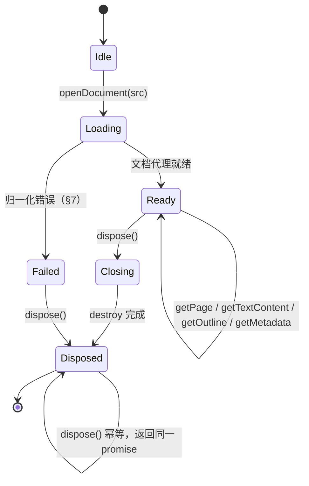

# 06 · PDF 引擎设计（M05）

> 把 `docs/02-system-architecture.md`（下称 **02**）中已冻结的架构展开为 M05 实现设计。**不新增任何契约名**：类型名、字段名、错误码、协议 URL 一律照抄 `docs/05-api-contracts.md`（下称 **05**）并给出可核对行号。
> 归属：M05 pdf-engine（03 §2 M05 卡第 73–82 行；文件归属 03 §4 第 222 行 `src/pdf-engine/**`）。视觉数值：本文档不含，全部进 §11.3。
> 纪律：pdfjs-dist 的具体 API 形态（签名、参数名、异常类名、导出路径）**一律不当作已确认事实**，统一由 V-01 探针（02 §1 第 30 行）关闭；本文档只规定「探针怎么跑、结论落到哪个文件」。

## 0. 与 master_plan §5.6 的对应

| §5.6 难点 | 章节 | 边界 |
|---|---|---|
| 1 Display / Viewer API 边界 | §1 | 本文档 |
| 3 Canvas / TextLayer / AnnotationLayer | §2、§3 | TextLayer 走 V-01 强制门禁 |
| 5 搜索文本 → 页面坐标 | §4 | 只交付**矩形**；高亮 DOM 属 M08 |
| 6 连续/单页共享 PDFDocument | §5 | 状态机 + 销毁顺序 |
| 7 渲染调度与缓存 | 08 | 本文档只给 M05 侧可渲染接口 |
| 12 Tauri 权限与目录访问 | 05 §6 | 引擎只认 `pdf://doc/{id}?v=` URL，不碰文件系统 |
| 13 资源释放与内存 | §6 | destroy / cleanup / worker |
| 4 当前搜索与全局搜索交互 | 07 | 不在本文档 |

## 1. Display API 与 Viewer API 的边界

**问题本质**：pdfjs-dist 同时发布解析渲染内核（Display）与官方阅读器 UI 的内部组件（Viewer，位于 `web/pdf_viewer` 一类入口）。后者无跨版本稳定性承诺，且自带默认 UI 与官方 CSS——正是 master_plan §3.2 明令不采用的东西（02 D02，第 292 行已冻结）。

**只用**（下表 pdfjs 符号是唯一允许出现在 `src/pdf-engine/adapter/` 的名字；签名由 V-01 抄录后填入 `adapter/version.ts`）：

| 能力 | pdfjs 符号 | 唯一封装处 | 冻结出口 |
|---|---|---|---|
| 打开文档 | `getDocument` | `adapter/loader-adapter.ts` | `PdfEngine.openDocument`（05 第 254 行） |
| 文档代理 | `PDFDocumentProxy` | 同上 | `DocumentHandle`（05 第 257–264 行） |
| 页代理 | `PDFPageProxy` | `page-handle.ts` | `PageHandle`（05 第 266–271 行） |
| 视口几何 | `page.getViewport` | `adapter/render-adapter.ts` | `PageGeometry`（05 第 273 行） |
| 位图渲染 | `page.render` | 同上 | `RenderTaskHandle`（05 第 281–284 行） |
| 文本内容 | `page.getTextContent` | `adapter/text-content-adapter.ts` | `TextContentHandle`（05 第 286–289 行） |
| 目录 | `doc.getOutline` | `outline.ts` | `OutlineNode[]`（05 第 293 行） |
| 元数据 | `doc.getMetadata` | `metadata.ts` | `PdfMetadata`（05 第 294–295 行） |
| 销毁 / 单页清理 | `doc.destroy`、`page.cleanup` | `resource-registry.ts` | `dispose`（05 第 263 行） |

**明确不用**：`PDFViewer`/`BaseViewer`（自带 DOM 骨架与工具栏语义）；`PDFPageView`（内部会再叠文本层与注释层，使 §3 版本风险翻倍，页结构须由 M07 自定）；`PDFFindController`（只认自己的 TextLayer 实例，而本项目搜索落在 M08/M11 两套数据源）；`PDFLinkService`/`PDFHistory`（导航归 M14 的 `useRouter` 与 `ReaderApi.goToPage`，05 第 331 行）；`AnnotationLayer(Builder)`（见 §2）；`web/pdf_viewer.css`（样式归 M13/M07，且会与 Tailwind 令牌冲突）。

**门禁（可执行）**：`no-restricted-imports` 禁 `pdfjs-dist/web/*`；CI 另跑 `grep -rln "pdfjs-dist" src/ | grep -v "^src/pdf-engine/"`，输出非空即失败（对应 02 §2 规则 2，第 57 行）。

**风险 / 影响**：分页布局、查找、文本层、进度恢复全部自写（D02 已接受的代价）；因此 M06/M07/M08 只能经 05 §7 的类型通信，拿不到 `PDFPageProxy`。

## 2. Canvas、TextLayer、AnnotationLayer 的关系

| 层 | 是什么 | 承载 | 本项目 |
|---|---|---|---|
| Canvas | `page.render` 产出的像素位图 | 页面全部可见内容（含扫描图像原色） | 实现（M05 产出，M06 持有） |
| TextLayer | DOM 层，每段文本一个定位节点 | 文本选择、复制、高亮矩形锚点 | 实现（`adapter/text-layer-adapter.ts`） |
| AnnotationLayer | DOM 层，把 PDF 注释渲染成可交互控件 | 批注、表单、签名 | **不实现** |

**不引入 AnnotationLayer 的三条独立理由（任一成立即足够）**：① master_plan §3.2「明确不需要的功能包括：注释、批注、签名等编辑功能」；② 数据面无归属——它需要注释的存储/提交语义，而 04 §3 全部 DDL（第 26–147 行）无注释表、05 §2 无注释 DTO，实现它等于凭空造契约；③ 官方实现属 Viewer 侧，直接违反 §1 门禁。

**层级与命中**：canvas 在底承接视觉与图片原色，TextLayer 覆盖其上承担选择命中。故**文本选择与复制完全由 TextLayer 决定，canvas 不参与 hit-test**；这也决定了 M08 的高亮矩形必须来自 TextLayer 几何而非 canvas 像素。z 值与覆盖范围见 §11.3。

**风险**：文本层与 canvas 若产生 1px 级错位，用户会觉得「选中的字和看到的字不一致」；验收式见 §4 末。

## 3. TextLayer 的实现与版本差异 → 强制走 V-01

**问题本质**：pdfjs-dist 历史上提供过两种文本层产出形态（一次性函数 / 类），且该类的归属（display 侧或 viewer 侧）随版本变动过。**实现路径必须先由探针判定**（02 §1 第 30 行 V-01，责任模块 M05），不得凭印象写代码。

**探针（每步都有判据）**：

```bash
npm view pdfjs-dist version                                   # P1 版本事实
node -e "console.log(require('./node_modules/pdfjs-dist/package.json').version)"  # P1 交叉核对，须一致
grep -rn "class TextLayer" node_modules/pdfjs-dist/types/ || echo "NO TextLayer class"   # P2
grep -rn "renderTextLayer" node_modules/pdfjs-dist/types/ || echo "NO renderTextLayer"   # P3
ls node_modules/pdfjs-dist/types/src/display/ node_modules/pdfjs-dist/types/src/web/ 2>/dev/null  # P4 归属
```

判据：P2 命中 → 逐字抄录构造签名（参数名/个数/可选性）与所属目录；仅 P3 命中 → 抄录函数签名；P2、P3 均未命中 → 直接走路径 B。

| | 路径 A：用官方 TextLayer | 路径 B：自绘绝对定位 span |
|---|---|---|
| 前提 | P2 命中且该类在 display 侧 | 只依赖 `getTextContent` 的 items，任何版本可用 |
| 优点 | 复用官方字距/缩放补偿/旋转累加 | 零版本依赖；坐标系与 §4、与 M08 高亮共用同一份实现 |
| 缺点 | 升级即可能失效，类内行为无文档承诺 | 自行处理 RTL/旋转/字距，像素对齐需自测 |
| 采用条件 | **P2 命中且连续两个次版本签名不变**才启用 | **默认路径** |

**推荐与理由**：默认 B、A 作可选加速。项目最怕的不是多写 80 行定位代码，而是「升级后文本层静默错位」——B 的坐标换算只有一处实现，错位只可能错在一个地方。

**隔离方案**（`src/pdf-engine/**` 归 M05，隔离在模块内即可）：

```ts
// src/pdf-engine/adapter/text-layer-adapter.ts —— 全项目唯一知道 TextLayer 形态的文件
export interface TextLayerHandle { destroy(): void }
export interface TextLayerPort {
  mount(container: HTMLElement, content: TextContentHandle, geometry: PageGeometry, scale: number): TextLayerHandle;
}
// 实现由 adapter/version.ts 的 TEXT_LAYER_VARIANT 常量在构建时静态选定
```

**门禁**：`scripts/probe-pdfjs-textlayer.mjs` 在 CI 复跑 P1–P4，结论写 `pdfjs-probe.json`；与 `TEXT_LAYER_VARIANT` 不一致即构建失败（防「升级了忘改适配」）。**影响**：M08 高亮依赖该坐标系，路径切换必须同时通过 §4 验收式；M06 完全不感知文本层。

## 4. 文本坐标映射基础

**问题本质**：PDF 文本位置是内容流里的文本空间矩阵，到页面 CSS 像素之间有两次仿射变换。任何一处顺序或符号错误都表现为整页文字偏移。

```text
viewport = page.getViewport({ scale: s, rotation: geometry.rotation })   // 参数名待 V-01 抄录
M        = mul(viewport.transform, item.transform)      // 文本空间 → 设备像素，6 元仿射 [a,b,c,d,e,f]

mul(m1, m2) =
  a = m1[0]*m2[0] + m1[2]*m2[1]
  b = m1[1]*m2[0] + m1[3]*m2[1]
  c = m1[0]*m2[2] + m1[2]*m2[3]
  d = m1[1]*m2[2] + m1[3]*m2[3]
  e = m1[0]*m2[4] + m1[2]*m2[5] + m1[4]
  f = m1[1]*m2[4] + m1[3]*m2[5] + m1[5]

left     = M[4]
baseline = M[5]
h        = hypot(M[2], M[3])        // 行高（CSS px，已含 scale）
top      = baseline - h             // 基线在底，div 顶须上移一个行高
width    = item.width * K           // K 由下面判据定，不猜
```

**rotation 如何参与**：旋转**不**单独乘矩阵——它已折叠进 `viewport.transform`（`getViewport` 的旋转参数），items 只需复合一次。写入 `PageGeometry` 时按 05 第 273 行的字面量取 `0|90|180|270`；90/270 时页面宽高互换。

**K 的判定（替代猜测）**：取页首标题行，分别以 `K=1`、`K=s` 渲染，与 canvas 上同一行墨迹右边界比对，`|textRight - inkRight| / pageWidth ≤ 1%` 者为正确；结论连同样本文件名写进 `adapter/version.ts`。

**归一化到契约类型**（05 第 291 行 `TextItem` 仅 6 字段、无 scale）：`item.x = M1[4]`、`item.y = M1[5]`、`item.width = item.width*K1`、`item.height = hypot(M1[2],M1[3])`、`item.fontSize = item.height`，其中 `M1` 取 `scale = 1`。即 **`TextItem` 单位 = 「scale=1 的页面 CSS 像素」（数值等于 PDF point）**，使用方自行乘 scale——否则每次缩放都要重建全部文本对象，文本缓存无法跨 scale 复用。

**y 轴自检（必进单测）**：`viewport.transform` 已把左下原点翻成左上原点，故第 1 页首行 `item.y` 必须满足 `0 < y < 0.15 * pageHeight`；若某版本给出负值或接近页高，说明符号约定变了 → 立即失败，不得「先跑起来看看」。

**交付给 M08 的面**：高亮矩形 = `{left: item.x*scale, top: item.y*scale, w: item.width*scale, h: item.height*scale}`。**契约缺口**：05 第 288 行只写 `text` 是「按阅读顺序拼接」，未规定分隔符，使「字符区间 → item」不可逆；建议固定「item 间无分隔符、行间插 `\n`」，M05/M08 共用同一 `mapCharRangeToRects`（见 §11.4）。

## 5. 文档生命周期状态机



| 状态 | 持有的资源 | 释放者 |
|---|---|---|
| Idle | 无 | — |
| Loading | `loadingTask`（可取消句柄） | dispose 取消之 |
| Ready | 文档代理、`PageProxy` 缓存、outline/metadata 惰性值 | `DocumentHandle.dispose` |
| Closing | 待完成的 destroy promise | 自身 |
| Disposed | 仅 `disposed` 标志与共享 promise | — |

**重复 close 幂等**：`dispose()` 内 `if (!this.#closing) this.#closing = this.#doDispose()`，后续调用 `await` 同一 promise。单测判据：连续调用 3 次，`destroy` 调用次数断言为 1，三次均 resolve。

**切换文档的顺序约束**（违反即撞上半销毁文档）：

```text
1. scheduler.setDocument(null)                  // 05 第 315 行，先让 M06 停发新任务
2. await scheduler.disposePageResources()       // M06 取消全部渲染并归还 canvas（08 §4）
3. await oldHandle.dispose()                    // 本模块 destroy 文档代理
4. newHandle = await engine.openDocument(next)  // 05 第 254 行
5. scheduler.setDocument(newHandle)
```

禁止并行 3 与 4：两个文档共存会同时占两个 worker 与两套解析缓冲，在 100MB 样本上直接突破 08 §9 的内存预算。禁止先 destroy 再取消渲染：未完成 render 的拒绝会写进 `PageRenderState.error`（05 第 303 行），用户看到的是「渲染失败」而不是「已取消」。

## 6. 资源释放与内存管理

**问题本质**：pdfjs 的页面操作符列表、解码图像与字体分布在 worker 与 JS 堆两侧，GC 看不到，只有显式清理口能让内存回落。

| 动作 | 时机 | 应当预期的副作用 | 判据 |
|---|---|---|---|
| `page.cleanup()` | M06 的 canvas LRU 逐出该页时通知 | 丢弃该页操作符列表，下次 render 需重新解析 | 清理后再 render 成功；重解析耗时埋点 `pdf.page.reparse`，上限 80ms 待 V-09 固化 |
| `doc.destroy()` | `dispose()` / 换文档 / 退出 | 后续 `getPage` 全部拒绝 | 之后任何 API 返回 `E_CANCELED`（05 第 56 行语义），不冒泡裸异常 |
| `loadingTask` 取消 | Loading 态 dispose | 中断字节下载 | 取消后 Network 面板无新请求 |
| canvas 位图释放 | M06 逐出 | `canvas.width = 0` / `height = 0` 立即回收位图 | 逐出后 `canvas.width === 0` |

**worker 复用**：**不假设** worker 是「全局共享」还是「一文档一个」（属 pdfjs 内部行为，契约未确认）。落地方式：`adapter/loader-adapter.ts` 模块初始化时只设置一次 worker 源（`GlobalWorkerOptions.workerSrc` 一类入口，名待 V-01 抄录），且**同时只允许一个 `DocumentHandle` 存活**（由 §5 顺序保证）——这样无论共享还是独占，都不会出现两文档抢 worker 的不可解释行为。

**泄漏判据**：打开→关闭循环 20 次后 JS 堆增长 < 20MB 且 `document.querySelectorAll("canvas").length === 0`；堆取不到时（见 08 §11）用 DevTools 三次手动快照看趋势。worker 线程数是否随打开次数增长 → V-10（§11.2）。

## 7. 错误归一化

契约只允许 12 个错误码（05 第 19–23 行）。引擎的职责是把 pdfjs 抛出的**任何**东西映射成其中之一，绝不把原始异常冒泡给 M06/M07。

| 触发条件 | 归类判据（异常名抄录后固化在 `error-map.ts`） | `ApiErrorCode` | `retriable` |
|---|---|---|---|
| 字节流 404 / 文件已消失 | `pdf://` 返回 404（05 §6 第 246 行） | `E_NOT_FOUND` | false |
| 字节流 403 | 协议返回 403 | `E_PERMISSION` | false |
| PDF 结构损坏、交叉引用表破损 | `getDocument` 拒绝且异常非密码类 | `E_PDF_CORRUPT` | false |
| 需要打开密码 | `getDocument` 拒绝且为密码类 | `E_PDF_ENCRYPTED` | false |
| 可打开但整本无文本 | `getTextContent` items 全空 | 引擎**不抛**，由 M09 落库时映射 `E_PDF_NO_TEXT`（05 第 53 行） | — |
| 单页渲染失败（局部损坏） | `page.render` 拒绝 | `E_PDF_CORRUPT`，仅该页 `state:"error"` | false |
| 渲染被取消 | `renderTask.cancel()` 后的拒绝（异常名待 V-01） | `E_CANCELED` | false |
| 超大文档 | 打开前按 `DocumentSourceDto.pageCount`（05 第 103 行）+ 文件大小 | **不映射为错误**：正常打开 + `console.warn` + 埋点；建议阈值 页数 > 5000 或 > 500MB，终值待 V-07 | — |
| 内存不足 / 引擎内部异常 | 其余全部，原文只进 `detail` | `E_INTERNAL` | true |

三条规则：① `detail` 可含原文，`message` 必须是中文短句；② 加密 PDF 不做密码框（产品决策，见 §11.3）；③ **取消不得写 `PageRenderState.error`**（05 第 303 行），否则用户缩放时满屏红字。

## 8. 版本升级策略

**固定方式**：`package.json` 用精确版本（`"pdfjs-dist": "x.y.z"`，无 `^`/`~`），提交 lock 文件；CI 首步断言：

```bash
node -e "const v=require('pdfjs-dist/package.json').version,e=require('./scripts/pdfjs-expected.json').version;if(v!==e){console.error('pdfjs drift',v,e);process.exit(1)}"
```

| # | 检查 | 动作 | 通过判据 |
|---|---|---|---|
| 1 | 版本一致性 | 上面的 CI 断言 | 无 drift |
| 2 | d.ts 差异 | `git diff` 两个版本的 `types/src/display/` | 每个 hunk 归类：无关 / 需改适配 |
| 3 | 文本层形态 | §3 的 P2/P3 | 与 `TEXT_LAYER_VARIANT` 一致，或显式升级该常量 |
| 4 | 字体与字符映射资源 | 核对包内 `standard_fonts`/`cmaps` 目录与路径 | 目录存在；中文样本页无方块字 |
| 5 | worker 路径与打包 | 核对 Vite 下 worker 引入方式（URL 导出或拷 public） | **生产构建**打开成功，控制台无 worker 404 |
| 6 | 构建目标兼容 | 是否需要 `legacy` 构建 | 目标 Windows 机器上生产包首屏成功 |
| 7 | `getTextContent` item 字段 | 打印一页首项键集合 | 含 §4 所需的 str / transform / width / height |
| 8 | 取消与销毁行为 | 单测：cancel 后拒绝、destroy 后调用 | §7 对应两行判据成立 |
| 9 | 样本冒烟 | §11.1 样本矩阵 | 全部可打开；抽 3 个过 §4 验收式 |

**回滚**：升级不与功能混提；失败即 revert 版本号 + `TEXT_LAYER_VARIANT` 两处。**风险**：第 4、5 项最易漏且不报错，只在某台机器上表现为「中文空白」或「worker 404」→ 必须进 M15 发布前人工清单（03 §2 M15 卡）。

## 9. 与 M06 的职责分界

依据 03 §2 M05 卡「不负责：决定渲染哪些页（M06）；绘制 UI；读取本地文件」（第 76 行）与 M06 卡「不负责：解析 PDF 字节；DOM 布局与样式；用户交互手势」（第 87 行）。

| 能力 | 归属 | 判据 |
|---|---|---|
| `getDocument`、页代理、文本内容、outline、metadata | M05 | 只有 M05 允许出现 pdfjs 符号 |
| 创建 canvas 并完成位图绘制（含 dpr 相乘，05 第 277 行注释） | M05 | `RenderTaskHandle.promise` 的解析值就是 canvas |
| 决定渲染哪些页、并发数、优先级、取消时机 | M06 | M05 不知道 `scrollTop`，也拿不到 `ViewportState` |
| canvas 挂载位置、CSS 尺寸、LRU 逐出 | M06 | M05 只交付一次 canvas，不持有引用 |
| 单页清理的**触发** | M06 | 触发后调 M05 提供的清理入口（§6） |
| 文本层 DOM 的**创建** | M05 | 它是 §3 版本风险的唯一隔离点 |
| 文本层 DOM 的挂载容器与样式 | M07 | 容器由阅读器提供 |
| 错误态呈现 | M07 | M05 只产出 `ApiError` |

越界判据：`src/render/**`（M06 归属，03 §4 第 223 行）出现 `pdfjs-dist` 或 `PDFPageProxy` 字样 → 缺陷。

## 10. `src/pdf-engine/` 文件划分与关键伪代码

| 文件 | 一句话职责 |
|---|---|
| `index.ts` | 唯一对外入口，只 re-export `types.ts` 与 `engine.ts` 工厂 |
| `types.ts` | 逐字镜像 05 §7 接口，不增删字段 |
| `engine.ts` | 实现 `PdfEngine.openDocument`，装配 handle 与资源册 |
| `document-handle.ts` | `DocumentHandle`：页代理缓存、outline/metadata 惰性化、`dispose` 幂等 |
| `page-handle.ts` | `PageHandle`：几何归一化，`render`/`getTextContent` 委托 adapter |
| `outline.ts` | outline 树与目标页解算（解不出时 `pageNo: null`，05 第 293 行允许） |
| `metadata.ts` | 元数据字段映射，缺失一律 `null` |
| `error-map.ts` | §7 映射表的唯一实现处 |
| `resource-registry.ts` | 记录所有代理与任务，保证 `dispose` 不漏 |
| `adapter/loader-adapter.ts` | 唯一调 `getDocument` 处；worker 源设置 |
| `adapter/render-adapter.ts` | 唯一调 `getViewport`/`render` 处；canvas 与 dpr 处理 |
| `adapter/text-content-adapter.ts` | 唯一调 `getTextContent` 处；§4 坐标归一化 |
| `adapter/text-layer-adapter.ts` | §3 两条路径的实现与选路 |
| `adapter/version.ts` | V-01 结论落盘（`TEXT_LAYER_VARIANT`、`K1`、异常名常量） |

```ts
// 只用 05 §7 冻结名；adapter 内部步骤按 V-01 抄录对齐
async function openDocument(src: { url: string; docId: number }): Promise<DocumentHandle> {
  const task = loaderAdapter.start(src.url);          // adapter: getDocument
  try { return new DocumentHandleImpl(src.docId, await task.promise); }  // proxy 提供 pageCount
  catch (e) { await task.cancelSafely(); throw errorMap.toApiError(e); } // §7
}

function render(req: RenderRequest): RenderTaskHandle {           // 05 第 270 行
  const vp = renderAdapter.viewport(this.geometry, req.scale);      // adapter: getViewport
  const canvas = renderAdapter.allocCanvas(vp, dpr());              // dpr 在引擎内部相乘
  const task = renderAdapter.start(vp, canvas, req);
  let canceled = false;
  return { promise: task.promise.then(() => canvas),
           cancel(): void { if (!canceled) { canceled = true; task.cancel(); } } }; // 幂等
}

async function getTextContent(): Promise<TextContentHandle> {      // 05 第 269 行
  const raw = await textAdapter.fetch(this.proxy);                  // adapter: getTextContent
  const items = raw.items.map(it => textAdapter.normalize(it, this.geometry)); // §4，scale=1
  return { items, text: textAdapter.join(items) };                  // join 规则见 §11.4
}
```

## 11. 风险、影响与未决项

**11.1 主要风险（按影响排序）**

| 风险 | 触发条件 | 已内置缓解 |
|---|---|---|
| 文本层与 canvas 错位 | 升级或 K 判错 | §3 门禁 + §4 验收式（行宽误差 ≤ 1%、行顶误差 ≤ 2px） |
| 换文档内存叠加 | 并行 open + dispose | §5 五步顺序 + §6 单 handle 约束 |
| 取消被当成失败 | render 拒绝未分类 | §7 规则 ③：取消不写 `error` |
| worker 生产误配 | 打包配置变更 | §8 checklist 第 5 项须跑生产构建 |
| 大文档 OOM | 单页 canvas 过大 / 缓存过大 | 08 §5 字节预算与逐出；引擎只提供清理口，不自行决策 |

**样本矩阵（§8 第 9 项引用）**：中文论文（含公式与图）、英文双栏、纯扫描件、加密、损坏（截断 50%）、1200 页以上、单页 > 20MB 扫描图、含大量矢量图、书签深度 > 3 层、A4/A5/Letter 混排、旋转 90° 页、零页文档。

**11.2 待验证清单**

| ID | 内容 | 验证方法 | 判据 |
|---|---|---|---|
| V-01（既有） | TextLayer 形态与相关签名 | §3 的 P1–P4 | 结论写入 `adapter/version.ts` 并附命令输出 |
| V-06（既有） | `pdf://` + Range 实际形态 | 最小壳工程发 `Range: bytes=0-` | 206 + `Content-Range` |
| V-07（既有） | 大 PDF 分段加载 | 300MB 样本测首屏与内存 | 首屏 < 800ms、峰值 < 900MB（08 §9） |
| V-08 | `cleanup()` 后重解析耗时与内存回落 | 单测 render→cleanup→render + 埋点 | 重解析 ≤ 80ms；堆回落 ≥ 单页位图量 |
| V-09 | worker 是否随打开次数增长 | 开关循环 20 次 | 线程数恒定 |

**11.3【待你确认】**

1. canvas 与 TextLayer 的层级顺序与 z 轴数值（结构上 canvas 在下已定，数值未定）。
2. 页面间隙与四周留白是否计入点击/悬停热区。
3. 是否支持「双击选词」与「跨页拖拽连续选中再复制」。
4. 缩放时的视觉过渡：允许短暂模糊放大，还是必须等清晰图（决定 08 §4、§9 的首帧策略）。
5. 加密 PDF 是否要密码框（属产品决策，非视觉，需你拍板；本版默认不做）。
6. `PageGeometry.rotation` 非 0 时是否对用户可见、是否提供手动旋转入口。

**11.4 契约缺口（Lead 已裁决，见 05 §11 修订记录）**

1. ~~`TextContentHandle.text` 拼接规则未定义~~ → **R1 已裁决**：新增 `itemStarts`，item 间无分隔符、行间 `'\n'`。本文档 §4 的映射按 R1 实现。
2. ~~`TextItem` 单位未定义~~ → **R2 已裁决**：scale=1 的页面 CSS 像素（= PDF point），使用方乘 scale。本文档 §4 保留该口径。
3. `RenderBudget` 默认值 / `setDocument` 释放语义 / `PageRenderState.scale` 语义 → 见 05 §11 的 **R3 / R4 / R5**。
