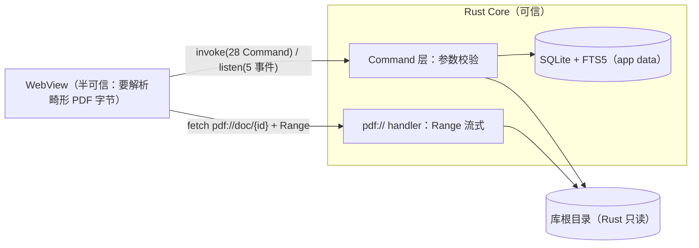

# 09 · 安全与权限设计

> 依据：`master_plan.md` §5.6 第 12 项（第 476 行「Tauri 2 文件权限与目录访问控制」）、§4.2；`docs/02-system-architecture.md` §3（字节流不过 IPC）、§10（日志）、D01/D12；`docs/05-api-contracts.md` §6（`pdf://` 协议契约）、§1（错误码）；`docs/04-database-design.md` §2（PRAGMA）、§5（迁移失败降级）。
> 本文档只写**可判定的规则**。视觉与交互形态一律进 §10【待你确认】。

## 1 信任边界



| 主体 | 能碰什么 | 明确不能碰什么 |
|---|---|---|
| WebView | 28 个 Command（05 §3）、5 个事件（05 §4）、`pdf://doc/{id}` | 任意文件路径读写、SQL、socket、进程、注册表、剪贴板以外的系统资源 |
| Rust Core | 库根目录（只读）、app data 目录（读写） | 库根之外的文件（`pdf://` 校验后拒绝，§3） |

三条不变量：

- **B1 文件访问唯一入口是 Rust。** WebView 拿不到也不该拿到任何路径 scope；`DocumentDetailDto.absPath`（05 §2 L86）是**展示用字符串**，不是访问凭据。
- **B2 路径不接受来自前端的输入。** 所有文件访问以 `document_id` / `library_root_id` 为主键在库内反查得到。
- **B3 PDF 字节不经 IPC。** 走 `pdf://` 的 Range 流（02 §3 L109、D01）。

## 2 Tauri 2 capabilities 最小化

capabilities 文件在 `src-tauri/capabilities/`（Tauri 2 默认已有 `default.json`）。

```json
{
  "identifier": "main-window",
  "description": "Legere 最小权限集：invoke 基础设施 + 目录选择",
  "windows": ["main"],
  "permissions": ["core:default", "dialog:default"]
}
```

| 权限 | 需要？ | 理由 |
|---|---|---|
| `core:default` | 是 | invoke / 事件 / 窗口 的基础能力，缺它连 Command 都调不通 |
| `dialog:default` | 是 | 「添加文献库」要系统目录选择器拿到一个绝对路径（05 §3 L175 `library_root_add`） |
| `fs:*` | **否** | PDF 由 Rust 读取并经 `pdf://` 输出；索引、备份、扫描全在 Rust 侧。一旦给 WebView 开 fs scope，「Rust 是唯一文件访问者」这条边界立即失效，且 scope 里的通配规则很难写对 |
| `shell:*` / `http:*` / `updater:*` / `notification:*` | 否 | 无外部进程、无网络（D12），首版不做自动更新与系统通知 |
| `clipboard-manager:*` | 暂不 | M07 的「文本选择与复制」优先用 `navigator.clipboard`；若在 WebView 中受限再评估插件，届时另行说明 |

必须做的两件事：

1. **不要在 `tauri.conf.json` 里开大范围 fs scope**（如 `{"fs": {"allow": ["**"]}}`）。本项目完全用不到；写上等于给未来任何一次 XSS 留了整盘读写。
2. `core:default` 是一个**权限集合**，其展开项由 Tauri CLI 生成到 `src-tauri/gen/schemas/` 下（文件名以生成结果为准）。实现第一步就打开该文件，把本项目用不到的子系统（如 tray/menu/image）从 capabilities 里换成逐条显式列出，而不是整包引用。

验收判据（可执行）：

- 在 DevTools 里调用一个未授权能力（例如 `window.__TAURI__.fs.readTextFile("C:/Windows/win.ini")`）→ 返回被拒绝（错误文本含 not allowed / denied），而不是文件内容；`npx tauri dev` 启动无 capability 校验告警。

## 3 `pdf://` 协议安全

契约：URL 为 `pdf://doc/{documentId}?v={mtime_ms}`，支持 GET/HEAD 与 `Range: bytes=start-[end]`，错误语义 404/403/400（05 §6 L243-L247）。

### 3.1 处理流程（顺序不可调换）

```text
fn handle(req) -> Response:
  1. 解析 path（先百分号解码）：必须是 "/doc/{id}"，id 为非负整数，否则 400
     path 段含 ".." 或 "/" 多余层级 → 400（防御性；正常流程根本不拼路径）
  2. row = SELECT d.id, d.abs_path, r.path AS root
             FROM documents d JOIN library_roots r ON r.id = d.library_root_id
             WHERE d.id = ?1 AND d.deleted_at IS NULL
     无行 → 404                      # 文档不存在或已软删除
  3. real = fs::canonicalize(row.abs_path)  失败 → 404    # 文件已消失
     root = fs::canonicalize(row.root)      失败 → 403    # 库根不可达
  4. real.starts_with(&root) == false → 403              # 符号链接 / junction 逃逸
     real.is_file() == false          → 404
  5. len = metadata(real).len(); 解析 Range（§3.2）→ 打开 real 读 [start, end]
     返回 206 + Content-Range / Content-Length / Content-Type: application/pdf / Accept-Ranges: bytes
```

### 3.2 Range 校验

| 情形 | 处理 |
|---|---|
| `bytes=start-`（end 省略） | `end = len-1` |
| `start >= len` 或 `end >= len` | 夹取到 `[min(start,len-1), len-1]`，`warn!` 记录 |
| `start > end` 或语法不匹配 | **忽略 Range，返回 200 + 全量流**（05 §6 L244 明确允许），`warn!` |
| 跨度 > `RANGE_MAX_BYTES = 8 MiB` | 截断为 `[start, start+8MiB-1]` 返回 206，PDF.js 会继续请求下一段 |
| 多段 Range（`bytes=0-9,20-29`） | 忽略，按单段处理（首段），`warn!` |

- **契约终裁（05 §6 / R15）**：`start >= size` → `416` + `Content-Range: bytes */{size}`；`end >= size` → 夹取到 `size-1` 返回 `206`（标准语义）；语法非法 → `400`。理由：`start` 越界若夹取，PDF.js 会把错位字节当目标区间解析，失败原因极难诊断；`end` 越界夹取则是服务端标准行为。
- `RANGE_MAX_BYTES = 8 MiB` 是本文档定义的常量（「单次读盘不产生可感知卡顿」的估算），须由 V-07（>300MB 分段行为，02 §1 L36）实测后调整。
- 缓存：`?v={mtime_ms}` 参与缓存键（05 §6 L243）。响应可带 `Cache-Control: private, max-age=3600`；**先验证**：改文件后 mtime 变化是否真的换 URL（若 WebView 忽略 query 仍用旧缓存，则改 `no-store`）。

## 4 CSP 与远程内容

在 `tauri.conf.json` 的 `app.security.csp`（Tauri 2 生成模板中的位置；键名以 CLI 的 schema 提示为准）设置：

```text
default-src 'self';
script-src  'self' 'wasm-unsafe-eval';
worker-src  'self' blob:;
style-src   'self' 'unsafe-inline';
img-src     'self' data: blob:;
font-src    'self';
connect-src 'self' pdf: http://pdf.localhost;
object-src  'none'; frame-src 'none'; base-uri 'self'; form-action 'none';
```

| 指令 | 取值理由 |
|---|---|
| `connect-src` 含 `pdf:` **与** `http://pdf.localhost` | 自定义 scheme 在 Windows 上的实际 URL 形态未定（V-06，02 §1 L35）。两种形态都写，等 V-06 关闭后删掉多余的那个。漏写会让 PDF 完全加载不出来 |
| `script-src 'self' 'wasm-unsafe-eval'` | pdfjs 的部分图像解码走 wasm。**先验证**：打开一个含 JPEG2000 的样本，若 Console 无 wasm 相关报错则删掉 `'wasm-unsafe-eval'`（取值范围最小化） |
| `worker-src 'self' blob:` | Vite 打包的 pdfjs worker 可能以 blob URL 启动；具体形态随 pdfjs 版本（V-01）变化 |
| `style-src 'self' 'unsafe-inline'` | React 的 `style` 属性与 13 §2 要求的 `transform`/CSS 变量都靠内联 style 写入；CSP3 中内联 style 属性受 `style-src-attr` 控制并回落到 `style-src`，缺 `'unsafe-inline'` 会被**静默丢弃**（不报错，只是没有 transform）。**先验证**：主页转盘的书脊应能通过 `getComputedStyle(el).transform` 读到非 `none` |
| `object-src 'none' / frame-src 'none'`；白名单无 https: | 禁止 `<object>`/`<iframe>` 载入内容（PDF 用 canvas 渲染）；任何远程 fetch/script/字体都被拦下——「无远程内容」是**机制性保证**，不是口头约定 |

补充约束：

- capabilities 里不配置任何远程域（Tauri 2 允许把 capability 限定到本地或远端来源；本项目只用本地）；生产构建不打 CDN 资源，字体必须随包内置（`font-src 'self'` 已强制）。
- 开发期 `devUrl` 指向 `http://localhost:1420` 属于 Tauri CLI 的默认开发机制，**不得**在 release 配置里保留任何远程 `devUrl`。
- 验收：打包产物在**断网**环境启动，全部功能可用（除「添加文献库」仍需本地目录外）。若某功能依赖网络，即为缺陷。

## 5 数据库与数据目录

- 位置：Tauri 的 `app_data_dir` 之下（由 `app_info` 命令返回 `dataDir`/`dbPath`，05 §3 L173，便于支持与自检）。测试与文档里一切路径判断都以该命令输出为准，不写死 `%APPDATA%` 路径。
- 权限：app data 目录由 M01 启动时创建（不存在则 `create_dir_all`）；若创建失败 → `E_PERMISSION`（05 §1 L50）并退出，不降级到临时目录（否则用户数据会散落）。
- PRAGMA 与连接策略见 04 §2（WAL / foreign_keys / busy_timeout=5000 / synchronous=NORMAL；单写多读）。

**备份**：推荐在线一致快照 `VACUUM INTO '<目标路径>'`（应用运行时可用，WAL 中未 checkpoint 的事务也被包含）；手工备份则必须复制 `legere.db`、`legere.db-wal`、`legere.db-shm` **三个文件**——只拷 `.db` 会丢掉 WAL 内容，表现为「最近的书签与进度消失」。

恢复：关闭应用 → 用备份的三个文件覆盖 app data 下的同名文件 → 启动后执行 `db_integrity_check`（05 §3 L199），四项计数与备份时一致即恢复成功。

**损坏与降级**

- 打开/迁移失败 → **只读降级**：所有写 Command 返回 `E_DB`，UI 顶部显示 `E_DB` 提示（04 §5 L169）。不得静默重建、不得删除库文件。
- 自检异常（FTS 行数 ≠ `page_text` 行数等）→ `db_integrity_check` 只报告不自动修（04 §6 L179）；修复入口是用户显式触发的 `index_rebuild_all`（§6）。另提供「把当前 `legere.db` 另存为 `legere.corrupt-<timestamp>.db`」这一条动作，让用户在重建前留证。

## 6 危险操作保护

| 操作 | Command | 语义（必须写进 UI 文案） | 保护 |
|---|---|---|---|
| 删除文献记录 | `document_record_delete`（05 §3 L183） | **只删库记录（含书签/进度/索引），不删磁盘上的 PDF 文件** | 二次确认，且确认框必须显示将丢失的书签数与进度页 |
| 移除库根 | `library_root_remove`（05 §3 L176，`purge`） | 同上，绝不删用户文件 | 二次确认；`purge` 语义见下 |
| 重建索引 | `index_rebuild_all`（05 §3 L188） | 清空 `page_fts` 与 `page_text` 后重新入队（04 §6 L180），重建期间搜索不完整 | 二次确认 + 显示待重建页数；完成后写日志 |

`purge` 语义在契约中**未定义**，本文档给出建议值并列入「契约待补充」：`purge=false` → 删除库根记录，`documents` 由外键级联清理（04 §3 L46 `ON DELETE CASCADE`）；`purge=true` → 额外执行 `VACUUM` 回收磁盘与 FTS 段合并。**两种取值都不删除磁盘上的 PDF 文件**——这条不得由实现自行放宽，因为它是「个人库」最不可承受的误操作。

不可逆性清单：只有「用户手动删了磁盘文件」是不可逆的；应用内所有删除都能通过重新扫描 + 重新索引恢复（书签与进度除外，所以它们在确认框里必须被点名）。

## 7 隐私与日志

| 允许记录 | 禁止记录 |
|---|---|
| 绝对路径、`document_id`、`job_id`、`size_bytes`、`mtime_ms`、错误码、`elapsed_ms`（字段清单见 02 §10 L284） | `page_text.raw_text` / `seg_text` 的**任何片段** |
| 查询串的**长度**与 token 数 | 查询串原文（用户可能粘贴正文片段搜索） |
| PDF 元数据字段的**是否存在**（`pdf_title IS NULL` 等） | 元数据全文（标题常含未发表工作） |

理由：日志滚动保存 7 天（02 §10 L284）且用户很可能在报 bug 时把日志整段贴出去；正文是个人文献库最私密的部分。路径允许出现是因为本机单用户、路径本身是排障必需信息。

错误上报：**无**。应用不发遥测、不联网（D12，02 §11 L302）。验收判据：打包产物的进程在 1 分钟空闲期内无对外 TCP 连接（`Get-NetTCPConnection -OwningProcess <pid>` 为空）。

## 8 Windows 特有注意

| 项 | 风险 | 处理 |
|---|---|---|
| 长路径（>260） | `File::open` 可能失败 | **先验证**：在库根下造 300 字符深度的文件，用 `std::fs::File::open` 打开。失败则访问前统一加 `\\?\\` 前缀（verbatim 路径不解析 `.`/`..`，因此必须先 `canonicalize` 再加前缀） |
| UNC 路径（`\\server\share`） | 可作为库根，但 `notify` 在 UNC 上事件可能丢失（V-05，02 §1 L34） | 允许添加，但该 root 只做启动扫描、不注册监控；在 UI 上标注「实时同步不可用」（样式【待你确认】） |
| OneDrive / 云占位文件 | 读取会触发按需下载，`spawn_blocking` 长时间阻塞，看起来像卡死 | 读取前查 Windows 属性位 `RECALL_ON_DATA_ACCESS(0x00400000)` / `RECALL_ON_OPEN(0x00040000)`（值以 Win32 文档为准，落地时用探针打印核对）；命中则：该任务降为后台优先级、不累加 `attempts`（避免把「云文件」误判为「损坏」，02 §6 L201）、超时 30s 后回 `text_state='pending'` 下轮再试 |
| 文件被占用 | Win32 错误 32（`ERROR_SHARING_VIOLATION`） | 映射为 `E_IO`(retriable=true)（05 §1 L49）；退避 1s/2s/4s 重试 3 次后保持 `pending`，**不得**标 `failed` |
| 只读属性 / ACL 拒绝 | 无法读取或被拒绝 | 映射为 `E_PERMISSION`（05 §1 L50） |
| 文件名大小写不敏感 | `abs_path` 二进制比较会把 `A.pdf` 与 `a.pdf` 当成两行，而 Windows 认为是同一文件；`A.pdf` → `a.pdf` 的重命名也会被当成新文件 | **已由契约 R17 解决**：04 §3 的 `documents` 增加 `abs_path_key`(UNIQUE) 与 `rel_path_key`，UNIQUE 改挂 `(library_root_id, rel_path_key)`；所有查重 / JOIN / 合并一律走 `*_key` 列，`abs_path` 仅用于展示与打开文件。重命名走 02 §8 的 rename 分支更新路径并保留 id（书签与进度不丢） |

## 9 打包与签名

资源清单（Windows 优先）：

| 资源 | 形态 | 校验与回退 |
|---|---|---|
| SQLite + jieba 词典 + 项目词表 | `rusqlite` 的 `bundled` feature 编进二进制（02 §1 L14）；词典用 `include_str!` 编译期内嵌 | 无需分发；启动时 `app_info` 返回 `ftsEnabled`/`contentlessDelete` 供排查 |
| pdfium 动态库（若采用） | 放 `src-tauri/resources/pdfium.dll`，经 Tauri 2 的 bundle resources 随包分发 | 启动时算 SHA-256 与打包清单比对，不符或加载失败 → **回退到纯 Rust 提取器**（03 M09 卡 L118 已规定两套实现）并 `warn!`；回退后 `page_text` 的结果可能与 pdfium 略有差异，属已知限制（D03 只要求「记录差异」） |

签名：Windows 未签名的安装包会触发 SmartScreen 警告。是否购买代码签名证书、走哪个分发渠道，属于**产品决策**（不在本文档范围，也不在 §10 的 UI 清单里）——首版建议先提供未签名的 `.msi`/`.exe` 并在 README 说明。

**对 V-06 的依赖（硬依赖，未关闭前不得冻结 CSP 与前端 URL 组装）**：`pdf://` 在 Windows WebView 上的实际 URL 形态决定 ① CSP 的 `connect-src` 该写几条 ② M05 拼 URL 还是拼原生 scheme 字符串 ③ 协议 handler 收到的 path 是否带 host 段。验证方法：最小壳工程注册 `pdf` scheme，用 `fetch("pdf://doc/1", { headers: { Range: "bytes=0-" } })` 与 `fetch("http://pdf.localhost/doc/1", ...)` 各打一次，记录状态码与 `Content-Range`。两种形态**都能工作**则按 05 §6 L243 的 URL 契约取前者。

**对 V-07 的依赖**：>300MB PDF 的分段加载实测决定 `RANGE_MAX_BYTES`（§3.2）取 8 MiB 是否合适；实测首屏时间与内存峰值后回填。

## 10 【待你确认】（纯视觉/交互形态，实现时留 `TODO(ui-confirm)`）

1. 二次确认用**系统原生弹窗**（`dialog` 插件）还是**应用内浮层**？原生弹窗不受 paper 主题影响，与暖色阅读界面观感割裂；应用内浮层要自己实现焦点陷阱与 Esc 语义。
2. 危险操作确认按钮的层级、位置与是否要求输入文字确认（例如要求输入库根名）。
3. `E_DB` 只读降级时顶部提示的形态：横幅 / 弹出层 / 状态栏，以及是否提供「导出日志」「另存损坏库」入口。
4. 备份与恢复是否提供 UI 入口，还是只在文档里给手工步骤。
5. UNC 库根与 OneDrive 占位文件在列表中的「受限/降级」标记样式。
6. 是否在界面上暴露 `dataDir`/`dbPath` 这类调试信息（以及暴露位置）。
