# 10 · 开发路线图

> 依据 master_plan.md §6（第 497–577 行：每阶段要给目标/前置/模块/交付物/验收/风险/完成条件）与 03 §3（第 187–205 行：串行主链与并行组 A–E）。
> 编号约定：**里程碑 `M0`–`M6` 与模块 `M01`–`M15` 属不同命名空间**，不得混用。

## 0. 编排原则

1. 串行主链 `M01 → M02 → M03` 不可并行：契约（M02）未冻结，任何人写的 DTO 都要返工；库（M03）未建，M04/M09/M12/M13 无表可用。
2. 主链打通后分两组并行：后端组 A/B/C/D（M04、M09→M10→M11、M12、M13）与前端组 E（M05→M06→M07→M08）。E 组只依赖 M02，**不必等任何 Rust 业务模块**（03 §3 第 205 行）。
3. 每个阶段结束必须「能演示一件事」，不能演示的阶段拆分或合并。
4. 阶段验收标准写成可判定的断言（命令 + 判据），不接受「功能正常」。
5. 契约里 V-01–V-07 未关闭的项，在对应阶段以「探针 → 结论落盘 → 再实现」的顺序处理；探针失败不阻塞其他阶段（02 §1 第 26 行）。
6. **契约笔误已修订（R6）**：02 §5 时序图原写作 `document_open_url(id)`，已改为 `document_url`，与 05 §3 第 9 行一致。实现一律用 `document_url`；后续若再发现此类不一致，按 05 §13 修订记录登记，不要各自"择优"。

## 1. Phase 0 · 工程基础

- **目标**：一个可运行的 Tauri 2 + React/TS 空壳，两条通道（`invoke` 请求-响应、`emit/listen` 单向事件）打通，契约层落成可编译的 Rust 结构与 TS 类型。
- **前置条件**：无（工程起点）。
- **涉及模块**：M01 foundation、M02 contracts。
- **交付物**：`ping` / `app_info` 命令；`app://ready` 事件；`ApiError` 双向类型；`CMD` / `EVT` 常量；`scripts/check-contracts.mjs`；`pdf://doc/{id}` 路由壳（先返回固定样本）；vitest 与 `cargo test` 可跑；`rust-toolchain.toml`。
- **验收标准**：
  1. `cargo test` 与 `npx vitest run` 全绿，退出码 0。
  2. `ping` 返回 `{ ok: true, version: string }`（05 §3 第 172 行）。
  3. `node scripts/check-contracts.mjs` 输出差集为空（05 §10 第 362 行）。
  4. `CMD` 常量集合 == Rust `#[tauri::command]` 注册集合（05 §10 第 363 行）；错误码 12 个变体一一对应（05 §1 第 18–32 行）。
  5. `pdf://` 的实际 URL 形态按 **V-06 探针结论**落定并写入日志：`fetch` 带 `Range: bytes=0-` 必须得到 `206` 或退化 `200`（05 §6 第 244 行）。形态以探针输出为准，不得凭记忆写死。
- **主要风险与缓解**：V-01 / V-06 未关闭 → 本阶段只交付协议壳，不写任何 pdfjs 适配代码；`main.rs` / `lib.rs` 会被多人追加 → 只允许「追加一行注册」并在交付报告声明（03 §4 第 211 行）。
- **完成条件**：上述 1–5 全过 + 交付报告归档 + V-06 结论写入 02 §1 的 V 清单旁注。
- **结束时可演示**：启动应用 → 触发 `ping` → 日志出现结构化字段（`module`/`elapsed_ms`）；浏览器面板里 `fetch("…/doc/1", { headers: { Range: "bytes=0-" } })` 拿到固定样本字节。

## 2. Phase 1 · PDF 引擎与阅读

- **目标**：用真实 PDF 跑通「打开 → 首屏 → 滚动 → 缩放 → 跳页 → 文内搜索高亮」，且不依赖任何 Rust 业务表。
- **前置条件**：M02 冻结；Phase 0 的 `pdf://` 壳可用；V-06 已有结论。
- **涉及模块**：M05 pdf-engine → M06 render-scheduler → M07 reader-interaction → M08 doc-search（并行组 E，串行链）。
- **交付物**：`PdfEngine` / `DocumentHandle` / `PageHandle` / `TextContentHandle`（05 §7 第 251–295 行）；`RenderScheduler`（第 314–321 行）；`ReaderApi`（第 327–333 行）；`createDocSearch`。
- **验收标准**：
  1. 连续 ↔ 单页切换后 `getDocument` 调用次数仍为 1（03 M07 第 104 行）——用 M05 内部计数器断言。
  2. `setViewport` 之后仅可视区 + 预取窗口的页进入 `ready`；同时存在的 `renderTask` ≤ `maxConcurrent`（默认 2，02 §9 第 274 行）。
  3. 快速滚动 3s 后残留 `renderTask` 数 = 0；`dispose()` 后再调 `dispose()` 不抛错（幂等，05 §7 第 320 行）。
  4. 损坏样本返回 `E_PDF_CORRUPT`，应用不崩溃（03 M05 第 82 行）。
  5. 文内搜索：中文子串、跨行 / 跨 `TextItem` 命中、空查询三种用例通过（03 M08 第 114 行）。
  6. 首屏可读 P95 ≤ 800ms（01 §5 N-01，普通样本）。
- **主要风险与缓解**：V-01（TextLayer API 形态未验证）→ 在 `src/pdf-engine/adapters/` 建立版本适配层，先读该版本 `types/` 声明再写代码，禁止照抄旧版 Viewer 实现；V-07（大文件分段加载）→ 首屏不达标时按 01 §3 C-07 的固定顺序调参（先 `prefetchPages`）。
- **完成条件**：1–6 全过；`src/render/**`、`src/reader/**` 中 `grep -R "pdfjs-dist"` 为 0 命中（02 §2 第 57 行）。
- **结束时可演示**：打开一本真实论文 → 连续滚到底 → 切单页 → 放大到 200% 看公式 → 输入关键词跳到命中页并高亮。

## 3. Phase 2 · 文献库管理

- **目标**：从磁盘到可浏览的文献列表，含增量判定与运行时监控。
- **前置条件**：M02 冻结；Phase 0 的事件通道可用。
- **涉及模块**：M03 database → M04 library（串行主链第三环 + 并行组 A）。
- **交付物**：迁移 `001_init`（04 §3 全部 8 张表）；Repository 实现；`DbCapabilities { fts5, contentlessDelete }`；递归扫描与增量判定；`notify` 监控 + 800ms 防抖；`library_*` / `document_*` 共 11 个命令；`library://scan-progress`、`library://changed`。
- **验收标准**：
  1. 迁移三条路径全过：空库 → 最新、001 库 → 最新、重复执行幂等（04 §9 第 202 行）。
  2. 增量三分支：新增 → insert + `text_state=pending`；`size`/`mtime` 变化 → 清旧 `page_text`/`page_fts` 并置 `pending`；文件消失 → `deleted_at` 置位并清索引（02 §8 第 245–247 行）。
  3. 同一路径重新出现 → 复活旧行，`id` 稳定（04 §4 第 155 行）。
  4. 删 root → documents 级联消失；删 document → 书签/进度/任务一并消失（04 §9 第 203 行）。
  5. 扫描期间 UI 可滚动、列表可分页；事件节流 `library://scan-progress` 200ms、`library://changed` 300ms（05 §4 第 215–216 行）。
  6. 无权限目录 → `E_PERMISSION`；损坏 PDF → `E_PDF_CORRUPT`；两者都不中断整轮扫描。
- **主要风险与缓解**：V-05（notify 在 Windows 的重命名事件语义未验证）→ 成对事件缺失时退化为「先删后增」，代价仅是该文档重新索引一次（02 §8 第 263 行），不得为对齐 rename 而拖延整轮扫描；下载中的半写文件 → `mtime` 距今 < 2s 跳过本轮（02 §8 第 262 行）。
- **完成条件**：1–6 全过；`db_integrity_check` 在干净库上返回空报告（05 §3 第 199 行）。
- **结束时可演示**：添加真实文件夹 → 列表出现 N 篇 → 在资源管理器里改名/删除/新增 → 不限刷新，列表自动跟上。

## 4. Phase 3 · 全文索引与库级检索

- **目标**：`page_text` / `page_fts` 落库、索引可暂停可恢复可重建、库级检索返回页码与上下文。
- **前置条件**：M03 的表与 Repository；M04 会发出索引任务请求（M04 不提取文本，03 第 67 行）。
- **涉及模块**：M09 text-index → M10 job-orchestrator → M11 global-search（并行组 B，串行链）。
- **交付物**：`TextExtractor` trait + 实现；jieba 分词器单例；`index_enqueue` / `index_cancel` / `index_status` / `index_pause` / `index_rebuild_all`；`index://progress`、`index://job-finished`；`search_global` / `search_global_count`；`GlobalSearchPanel`。
- **验收标准**：
  1. V-03 探针结论落盘：`content=''` + `contentless_delete=1` 可用 → 走主分支；不可用 → 自动降级为普通 FTS5 表（同列、去掉 `content=''`），且**全量用例在降级分支下同样通过**（D10 第 300 行；04 §9 第 206 行）。
  2. `SELECT COUNT(*) FROM page_fts WHERE rowid NOT IN (SELECT id FROM page_text)` = 0，且反向同样为 0（04 §4 第 157 行）。
  3. rowid 复用回归：单页连续「插入-删除-插入」3 轮后查询不得返回已删内容（04 §9 第 204 行）。
  4. 扫描版样本 → `text_state=no_text` 且不再重试；加密样本 → `failed` 且进程存活（03 M09 第 124 行）。
  5. 索引吞吐 ≥ 8 页/秒；打开某文档后其 `priority=0` 任务先于既有 `priority=10` 任务被取走（02 §9 第 272–277 行）。
  6. 100k 页合成库 `search_global` P95 ≤ 300ms；含 `" * ( ) : ^ -` 等特殊字符与 <3 字符中文查询均返回合理结果不报错（03 M11 第 144 行；04 §7 第 188 行）。
  7. 崩溃恢复：强行结束进程后重启，`text_state=indexing` 回 `pending`、`state=running` 的任务回 `queued`（04 §6 第 178 行）。
- **主要风险与缓解**：V-04（分词对称性）→ 建固定语料回归集，同一文本切分两次必须逐字相同，查询串与文档串使用同一词典配置（02 §1 第 33 行）；检索质量无回归网 → 12-testing-strategy.md 里放「已知查询 → 期望命中页」的黄金集。
- **完成条件**：1–7 全过；`db_integrity_check` 三项计数均为 0。
- **结束时可演示**：输入「中文分词」→ 列出若干部文献与命中页上下文 → 点击直接进阅读器并高亮到该页。

## 5. Phase 4 · 阅读辅助与主页接线

- **目标**：书签、进度、主题、设置可用；主页转盘从 mock 数据源切到真实数据源。
- **前置条件**：M03；M04/M11/M12/M13 的对外接口就绪（M14 可以先对 mock 开发，但必须在本阶段结束前切真实源）。
- **涉及模块**：M12 bookmarks-progress（C）、M13 theme-settings（D）、M14 workspace-shell（汇聚）。
- **交付物**：`bookmark_list/create/update/delete`、`progress_get/save`、`settings_get_all/set`；三套 `ThemeTokens`；`AppShell` + `HomeSpace`（真实 `HomeDataSource`）；`BookmarkList`、`useProgressPersistence()`。
- **验收标准**：
  1. 删文档 → `bookmarks` / `reading_progress` 级联消失（04 §9 第 203 行）。
  2. 进度节流 1s 且不丢最后一次；恢复时 `page_no` 按新 `page_count` 夹取（03 M12 第 154 行；04 §4 第 161 行）。
  3. 三套主题令牌名集合相等；非法值回退默认不抛错（03 M13 第 164 行）。
  4. 转盘 `N = 0 / 1 / 2 / 12 / 60` 五档不崩、不糊、可键盘操作；隐藏弧 DOM 数 = 0（`document.querySelectorAll("[data-home-spine]").length ≤ ceil(visibleArc/360×N)+2`）（13 §8 第 146–147 行）。
  5. 拖拽 3s：React 重渲染次数 = 0、无 >16ms 长任务、≥55fps（N=60）（13 §5 第 117–119 行）。
  6. 本阶段结束前 `grep -R "__MOCK__" src/` 输出为空（13 §4 第 110 行）。
- **主要风险与缓解**：视觉数值全部未定 → 一律留 `TODO(ui-confirm)` 并进交付报告「待确认问题」，不得为「看起来完整」编造一套视觉（_shared-context.md F 节第 70 行）；mock 分支残留 → 把「`__MOCK__` 清零」写成阶段完成条件，而不是待办。
- **完成条件**：1–6 全过；13 §7 的十条待确认项在交付报告里逐条给出「当前实现取值 + 待确认问题」。
- **结束时可演示**：主页转盘选一本 → 读几页 → 加书签 → 关闭 → 重进主页仍在上一本书同一角度 → 切三套主题。

## 6. Phase 5 · 集成与优化

- **目标**：端到端验收、性能基线、打包产物。
- **前置条件**：Phase 0–4 全部合并到主干且各自验收通过。
- **涉及模块**：M15 integration-release（+ 全部模块的缺陷修复）。
- **交付物**：集成测试脚本；真实 PDF 样本库（正常 / 大文件 / 扫描版 / 加密 / 损坏）；性能基线报告（01 §5 全表）；Windows 打包产物；已知限制文档。
- **验收标准**：
  1. 01 §5 的 N-01–N-08 全部达标，或逐条记录偏差数值与原因（不允许「大致可以」）。
  2. `db_integrity_check` 返回空报告（05 §3 第 199 行）。
  3. 干净 Windows 用户下安装启动成功；`db_reset` 不出现在 release 构建（04 §5 第 170 行）。
  4. `grep -R "__MOCK__" src/` 与 `grep -R "@ts-ignore" src/` 均为空；`grep -R "pdfjs-dist" src/reader src/workspace` 为空。
  5. `node scripts/check-contracts.mjs` 退出码 0；Command 注册集合 == 28（05 §3 第 172–199 行）。
- **主要风险与缓解**：最后一公里（mock 残留、契约漂移、降级分支未测）→ 见 11-agent-workflow.md §6 的七条与各自判据。
- **完成条件**：上述 1–5 全过 + 验收报告归档 + 已知限制文档发布。
- **结束时可演示**：从空机安装 → 加库 → 等索引跑完 → 库级检索定位到某页 → 读完并留下书签，全程控制台无报错、无未处理 Promise。

## 7. 关键路径图

```mermaid
gantt
  axisFormat %W
  dateFormat X
  section 串行主链
  M01 foundation           :m01, 0, 1w
  M02 contracts            :m02, after m01, 1w
  M03 database             :m03, after m02, 1w
  section 并行组 A/B/C/D（后端）
  M04 library              :m04, after m03, 2w
  M09 text-index           :m09, after m03, 2w
  M10 job-orchestrator     :m10, after m09, 1w
  M11 global-search        :m11, after m10, 1w
  M12 bookmarks-progress   :m12, after m03, 1w
  M13 theme-settings       :m13, after m03, 1w
  section 并行组 E（前端）
  M05 pdf-engine           :m05, after m02, 2w
  M06 render-scheduler     :m06, after m05, 1w
  M07 reader-interaction   :m07, after m06, 1w
  M08 doc-search           :m08, after m07, 1w
  section 汇聚
  M14 骨架（mock 数据源）  :m14a, after m02, 2w
  M14 接线（真实数据源）   :m14b, after m11, 1w
  M15 integration-release  :m15, after m14b, 2w
```

读法：条形长度是**相对工作量示意**，不是对外承诺的日历排期。真正被依赖锁死的是先后关系，不是周数。串行主链 `M01 → M02 → M03` 决定第一批并行能否开工；`M14 接线` 必须等 `M11` 与 `M04`，因此它是全项目的汇聚点（03 §3 第 187–205 行）。

## 8. 里程碑

| 里程碑 | 名称 | 判定条件（可核查） | 涉及模块 |
|---|---|---|---|
| M0 | 工程骨架可跑 | `ping` 返回 `{ ok:true, version }`；`app://ready` 送达；`pdf://` 壳返回固定样本字节 | M01 |
| M1 | 契约冻结 | `check-contracts.mjs` 差集为空；`CMD` 集合 == 注册集合；错误码 12 个一一对应 | M02 |
| M2 | 阅读器可读真实 PDF | 打开真实样本 → 首屏 ≤ 800ms；模式切换 `getDocument` 次数 = 1；文内搜索命中并高亮 | M05 M06 M07 M08 |
| M3 | 文献库可用 | 扫描入库；增量三分支正确；外部改名/删除自动跟上；事件节流达标 | M03 M04 |
| M4 | 库级检索可用 | `page_fts.rowid` 与 `page_text.id` 双向 0 差异；100k 页 P95 ≤ 300ms；点击结果跳到命中页 | M09 M10 M11 |
| M5 | 阅读辅助完整 | 书签/进度/主题往返成功；转盘 N=0/1/2/12/60 不崩且隐藏弧 DOM = 0；`__MOCK__` 清零 | M12 M13 M14 |
| M6 | 可发布 | 01 §5 全表达标或有记录的偏差；干净机安装可启动；`db_integrity_check` 空报告 | M15 |

## 9. 阶段与模块映射

| 阶段 | 模块 | 并行组 | 阶段产出的一句话判据 |
|---|---|---|---|
| Phase 0 | M01 M02 | 主链 | 两条通道打通、契约可编译、协议壳可用 |
| Phase 1 | M05 M06 M07 M08 | E | 真实 PDF 可读、可滚、可缩、可搜 |
| Phase 2 | M03 M04 | 主链 + A | 文件夹 → 列表，外部改动自动跟随 |
| Phase 3 | M09 M10 M11 | B | 索引落库 + 库级检索带页码与上下文 |
| Phase 4 | M12 M13 M14 | C + D + 汇聚 | 书签/进度/主题可用 + 转盘接真实数据 |
| Phase 5 | M15 | 汇聚 | 性能基线 + 打包 + 已知限制 |

跨阶段注意：M03 的 FTS5 能力探针（V-03）虽在 Phase 2 的模块里，但结论影响 Phase 3 的存储分支；因此 Phase 2 结束前必须跑一次探针并把结果写进日志（02 §1 第 32 行）。
